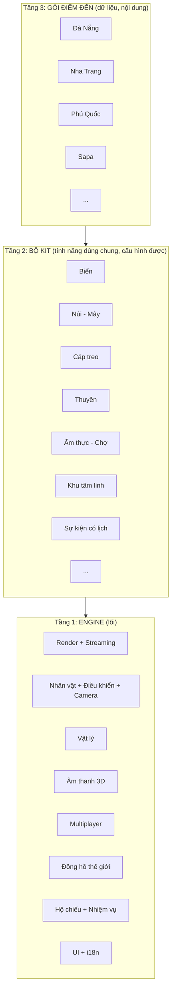
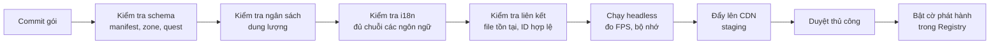
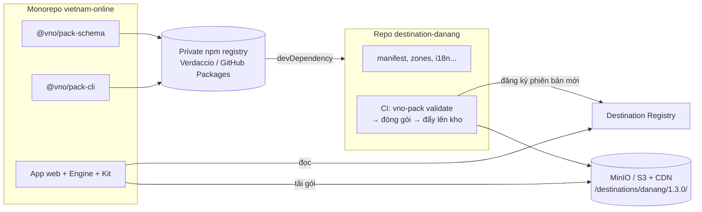
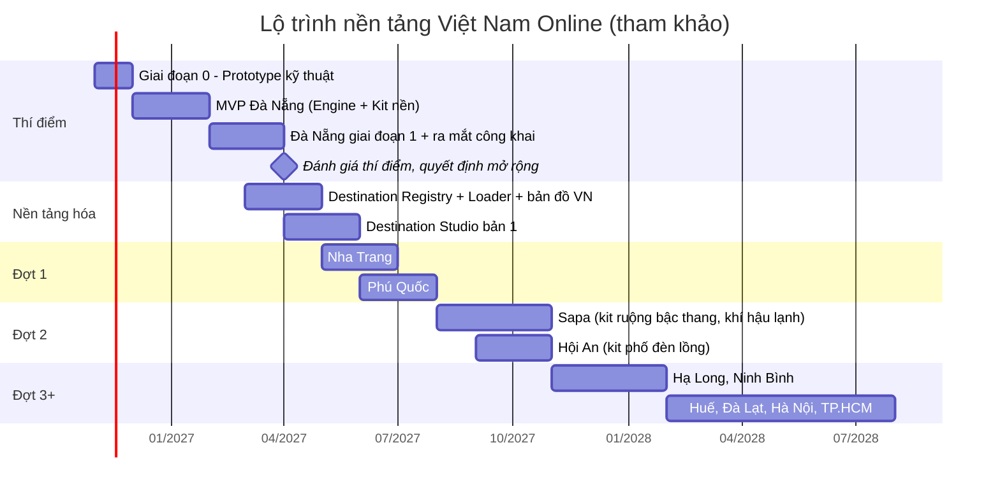

# VIỆT NAM ONLINE — Kế hoạch tổng thể nền tảng du lịch ảo 3D

> *"Đi khắp Việt Nam từ một màn hình"*

| Thông tin | Chi tiết |
|---|---|
| Tên nền tảng | Việt Nam Online (tên tạm) |
| Loại sản phẩm | Nền tảng du lịch ảo 3D đa điểm đến, chạy trên trình duyệt (Web + PWA), nhiều người chơi |
| Điểm đến thí điểm | #01 Đà Nẵng (xem `01-DaNang-Diem-den-thi-diem.md`) |
| Điểm đến dự kiến | Nha Trang, Phú Quốc, Sapa, Hạ Long, Hội An, Huế, Đà Lạt, Ninh Bình, Hà Nội, TP.HCM… |
| Phiên bản tài liệu | v2.0 |
| Người phụ trách | AnhNX |

### Hệ thống tài liệu

| File | Vai trò |
|---|---|
| `00-Ke-hoach-nen-tang.md` (tài liệu này) | Tầm nhìn, kiến trúc dùng chung, chuẩn gói điểm đến, chiến lược mở rộng. **Là tài liệu chuẩn khi có khác biệt.** |
| `01-DaNang-Diem-den-thi-diem.md` | Phân cảnh, tour, nội dung chi tiết của Đà Nẵng và mục tiêu thí điểm |
| `02-Thiet-ke-choi-cung-nhau-va-voice.md` | Gặp gỡ tại cùng địa điểm, nhóm bạn đi cùng nhau, voice chat qua mic, an toàn cộng đồng (áp dụng mọi điểm đến) |
| `03-Ban-web-v1.md` | Bản web đầu tiên đã code (thư mục `web/`): phạm vi, **các điều chỉnh so với 00–02 và lý do**, cách chạy, việc tiếp theo |
| `1x-<TenDiemDen>.md` (sau này) | Mỗi điểm đến mới có một tài liệu riêng theo khung ở mục 19.2 |

---

## Mục lục

1. [Tầm nhìn và định vị](#1-tầm-nhìn-và-định-vị)
2. [Chiến lược: thí điểm Đà Nẵng rồi nhân rộng](#2-chiến-lược-thí-điểm-đà-nẵng-rồi-nhân-rộng)
3. [Mô hình nền tảng: Engine, Kit, Gói điểm đến](#3-mô-hình-nền-tảng-engine-kit-gói-điểm-đến)
4. [Trải nghiệm xuyên điểm đến](#4-trải-nghiệm-xuyên-điểm-đến)
5. [Bộ Kit dùng chung](#5-bộ-kit-dùng-chung)
6. [Kiến trúc kỹ thuật đa điểm đến](#6-kiến-trúc-kỹ-thuật-đa-điểm-đến)
7. [Chuẩn Gói điểm đến (Destination Pack)](#7-chuẩn-gói-điểm-đến-destination-pack)
8. [Công cụ nội bộ: Destination Studio](#8-công-cụ-nội-bộ-destination-studio)
9. [Quy trình sản xuất một điểm đến mới](#9-quy-trình-sản-xuất-một-điểm-đến-mới)
10. [Tiêu chí chọn và thứ tự mở rộng](#10-tiêu-chí-chọn-và-thứ-tự-mở-rộng)
11. [Hồ sơ sơ bộ các điểm đến dự kiến](#11-hồ-sơ-sơ-bộ-các-điểm-đến-dự-kiến)
12. [Đối tác chiến lược](#12-đối-tác-chiến-lược)
13. [Mô hình kinh doanh ở quy mô nền tảng](#13-mô-hình-kinh-doanh-ở-quy-mô-nền-tảng)
14. [Pháp lý ở quy mô nhiều điểm đến](#14-pháp-lý-ở-quy-mô-nhiều-điểm-đến)
15. [Lộ trình nhiều giai đoạn](#15-lộ-trình-nhiều-giai-đoạn)
16. [Đội ngũ theo giai đoạn](#16-đội-ngũ-theo-giai-đoạn)
17. [KPI và tiêu chí chuyển giai đoạn](#17-kpi-và-tiêu-chí-chuyển-giai-đoạn)
18. [Rủi ro cấp nền tảng](#18-rủi-ro-cấp-nền-tảng)
19. [Phụ lục](#19-phụ-lục)

---

## 1. Tầm nhìn và định vị

### 1.1. Tầm nhìn

Trở thành **nền tảng du lịch ảo hàng đầu về Việt Nam**, nơi người dùng trong và ngoài nước có thể "đi" qua các điểm đến nổi tiếng với hình ảnh, âm thanh, thời tiết và sự kiện bám sát thực tế, gặp gỡ người khác, và từ đó lên kế hoạch cho chuyến đi thật.

### 1.2. Định vị

| Không phải | Mà là |
|---|---|
| Một game riêng về Đà Nẵng | Một nền tảng, mỗi điểm đến là một "gói nội dung" |
| Tour ảo 360° tĩnh | Thế giới 3D đi lại tự do, nhiều người chơi, thời gian thực |
| Sản phẩm bắt trend ngắn hạn | Sản phẩm du lịch dài hạn, trend chỉ là điểm khởi động |
| Mỗi điểm đến viết lại code | Thêm điểm đến chủ yếu bằng **dữ liệu và nội dung** |

### 1.3. Ba nhóm giá trị

1. **Người dùng:** trải nghiệm du lịch giải trí, khám phá trước khi đi, kết nối cộng đồng.
2. **Ngành du lịch:** kênh quảng bá điểm đến, công cụ giới thiệu tour, dẫn khách thật.
3. **Đội phát triển:** một nền tảng công nghệ có thể nhân rộng, tài sản dữ liệu quét 3D độc quyền tích lũy theo thời gian.

---

## 2. Chiến lược: thí điểm Đà Nẵng rồi nhân rộng

### 2.1. Vì sao chọn Đà Nẵng làm thí điểm

Đà Nẵng hội tụ gần như **mọi loại địa hình và trải nghiệm** mà các điểm đến khác cũng có. Làm xong Đà Nẵng nghĩa là đã xây được phần lớn bộ Kit dùng chung.

| Loại trải nghiệm | Ở Đà Nẵng | Sẽ tái sử dụng cho |
|---|---|---|
| Biển, bãi cát | Mỹ Khê | Nha Trang, Phú Quốc, Quy Nhơn, Vũng Tàu |
| Sông, cầu, đèn đêm | Sông Hàn, Cầu Rồng | Hà Nội, TP.HCM, Huế, Hội An |
| Núi, mây, sương | Bà Nà, Sơn Trà | Sapa, Đà Lạt, Hà Giang |
| Cáp treo | Bà Nà | Fansipan, Hòn Thơm, Nha Trang, Yên Tử |
| Du thuyền | Sông Hàn | Hạ Long, Tràng An, Mekong |
| Hang động | Ngũ Hành Sơn | Phong Nha, Hạ Long, Tràng An |
| Chùa, khu tâm linh | Linh Ứng | Bái Đính, Yên Tử, Huế |
| Chợ, ẩm thực | Chợ Hàn, Chợ Cồn | Mọi điểm đến |
| Phố cổ | Hội An (giai đoạn sau) | Hà Nội phố cổ, Huế |
| Sự kiện đêm | Cầu Rồng phun lửa | Pháo hoa, lễ hội các nơi |

### 2.2. Thí điểm phải trả lời được những câu hỏi gì

| # | Câu hỏi | Cách đo |
|---|---|---|
| 1 | Người dùng có thấy "giống thật" và muốn quay lại không? | Tỷ lệ quay lại ngày 7, khảo sát cảm nhận |
| 2 | Pipeline quét thực địa → web có cho chất lượng đủ tốt với chi phí chấp nhận được không? | Thời gian, chi phí sản xuất mỗi khu |
| 3 | Chạy được trên điện thoại tầm trung không? | FPS, tỷ lệ thoát khi tải |
| 4 | Multiplayer và sự kiện thời gian thực có tạo hiệu ứng lan truyền không? | Người online đồng thời lúc sự kiện, lượt chia sẻ |
| 5 | **Kiến trúc có thực sự tái sử dụng được không?** | Tỷ lệ code nằm trong Engine/Kit so với code riêng Đà Nẵng |
| 6 | Doanh nghiệp, đối tác có quan tâm không? | Số đối tác đồng ý thử nghiệm |

### 2.3. Quy tắc vàng khi làm thí điểm

> **Mọi thứ viết cho Đà Nẵng phải được viết như thể ngày mai sẽ dùng cho Nha Trang.**

- Không có code nào chứa tên "Đà Nẵng", "Mỹ Khê", "Cầu Rồng". Những thứ đó chỉ nằm trong **dữ liệu** của gói điểm đến.
- Cầu Rồng phun lửa được xây như một **kit sự kiện có lịch** (`ScheduledSpectacle`), không phải tính năng riêng.
- Cáp treo Bà Nà được xây như **kit cáp treo tổng quát** chạy theo đường spline bất kỳ.
- Mục tiêu đo được: **ít nhất 80% code nằm trong Engine và Kit**, tối đa 20% là mã đặc thù (kịch bản, hoạt cảnh riêng).

---

## 3. Mô hình nền tảng: Engine, Kit, Gói điểm đến

### 3.1. Ba tầng



| Tầng | Chứa gì | Ai làm | Thay đổi khi thêm điểm đến mới? |
|---|---|---|---|
| Engine | Render, điều khiển, vật lý, mạng, âm thanh, hệ thống nhiệm vụ, UI | Lập trình viên lõi | Không |
| Kit | Biển, núi, cáp treo, thuyền, chợ, sự kiện… mỗi kit nhận tham số | Lập trình viên + technical artist | Chỉ khi điểm đến cần **loại trải nghiệm mới** |
| Gói điểm đến | Splat, mesh va chạm, âm thanh thu tại chỗ, cấu hình khu, nhiệm vụ, thuyết minh, sự kiện | Đội nội dung, 3D artist, người quét thực địa | Luôn luôn (đây là phần thêm mới) |

### 3.2. Nguyên tắc "thêm điểm đến = thêm dữ liệu"

Khi mở Nha Trang, lý tưởng là đội phát triển **không phải deploy lại client**. Chỉ cần:

1. Đưa gói Nha Trang lên kho asset (CDN).
2. Đăng ký điểm đến trong Destination Registry.
3. Bật cờ phát hành.

Client tải manifest, thấy điểm đến mới trên bản đồ Việt Nam, người dùng bay tới được ngay.

---

## 4. Trải nghiệm xuyên điểm đến

### 4.1. Bản đồ Việt Nam (màn hình chính của nền tảng)

- Khi mở ứng dụng, người dùng thấy **bản đồ Việt Nam 3D** (dùng 3D Tiles hoặc mô hình địa hình), các điểm đến hiện dạng ghim phát sáng.
- Mỗi ghim hiển thị: số người đang online, thời tiết thật lúc này, sự kiện sắp diễn ra (ví dụ "Cầu Rồng phun lửa sau 25 phút", "Sapa đang có sương mù").
- Điểm đến chưa mở hiển thị dạng "Sắp ra mắt" kèm nút đăng ký nhận thông báo, dùng để **đo nhu cầu trước khi đầu tư**.

### 4.2. Di chuyển giữa các điểm đến

| Phương thức | Khi nào | Cảnh chuyển tiếp |
|---|---|---|
| Máy bay | Điểm đến xa (Đà Nẵng → Phú Quốc) | Cảnh trong khoang máy bay, nhìn qua cửa sổ, hạ cánh xuống sân bay điểm đến |
| Tàu hỏa | Tuyến Bắc – Nam (tùy chọn, cho người thích chậm) | Cảnh cửa sổ tàu qua đèo, đồng lúa, ga |
| Xe khách, xe máy | Điểm đến gần (Đà Nẵng → Hội An, Hà Nội → Ninh Bình) | Cảnh đường đi |
| Bay nhanh | Đã từng đến điểm đó | Camera bay qua bản đồ rồi hạ xuống |

Cảnh **sân bay** và **khoang máy bay** là kit dùng chung, mỗi điểm đến chỉ cấu hình sân bay riêng.

### 4.3. Hộ chiếu Việt Nam

- Một cuốn hộ chiếu duy nhất cho toàn nền tảng, **mỗi điểm đến là một trang**.
- Danh hiệu cấp điểm đến ("Thổ địa Đà Nẵng") và cấp quốc gia:

| Danh hiệu quốc gia | Điều kiện |
|---|---|
| Lữ khách | Ghé 3 điểm đến |
| Người đi biển | Hoàn thành bộ dấu biển ở 3 điểm đến biển |
| Người chinh phục mây | Đi cáp treo ở 3 điểm đến |
| Xuyên Việt | Có dấu ở cả miền Bắc, Trung, Nam |
| Đại sứ du lịch | Hoàn thành tất cả điểm đến đã phát hành |

### 4.4. Hành trình xuyên Việt

Tour liên điểm đến, chơi qua nhiều phiên:

| Hành trình | Lộ trình gợi ý |
|---|---|
| Miền Trung di sản | Huế → Đà Nẵng → Hội An |
| Biển đảo phương Nam | Nha Trang → Phú Quốc |
| Núi rừng Tây Bắc | Hà Nội → Sapa → Hà Giang |
| Xuyên Việt | Hà Nội → Hạ Long → Huế → Đà Nẵng → Nha Trang → TP.HCM → Phú Quốc |

### 4.5. Lịch sự kiện toàn quốc

Mỗi điểm đến có sự kiện riêng theo thời gian thật, gom vào **một lịch chung** để luôn có lý do quay lại:

| Loại | Ví dụ |
|---|---|
| Hằng ngày | Bình minh biển (Mỹ Khê, Nha Trang), hoàng hôn (Phú Quốc), biển mây buổi sáng (Sapa) |
| Hằng tuần | Cầu Rồng phun lửa, chợ đêm |
| Theo mùa | Mùa lúa chín ruộng bậc thang, mùa hoa, mùa băng tuyết hiếm hoi trên núi cao |
| Lễ hội | Tết Nguyên đán, Trung thu, lễ hội pháo hoa, rằm phố cổ thả đèn |

### 4.6. Đa ngôn ngữ

Từ ngày đầu hỗ trợ **tiếng Việt và tiếng Anh**; sau đó thêm tiếng Hàn, tiếng Trung (thị trường khách quốc tế lớn của nhiều điểm đến). Thuyết minh, tên địa điểm, nhiệm vụ đều đi qua hệ thống i18n, không viết cứng trong code.

---

## 5. Bộ Kit dùng chung

### 5.1. Danh mục Kit

| Kit | Chức năng | Tham số cấu hình chính | Làm ở |
|---|---|---|---|
| **Ocean** | Biển, sóng, bọt, cát ướt | Màu nước nông/sâu, độ cao sóng, hướng bờ, độ trong | Đà Nẵng |
| **River / Lake** | Sông, hồ, phản chiếu đèn | Tốc độ dòng chảy, độ đục, phản chiếu | Đà Nẵng |
| **Physical Sky** | Bầu trời, mặt trời, mặt trăng, sao | Tọa độ điểm đến | Đà Nẵng |
| **Weather** | Mưa, sương, gió, nhiệt độ | Vị trí lấy dữ liệu thời tiết, độ cao | Đà Nẵng |
| **Mountain Atmosphere** | Mây thể tích, biển mây, sương núi | Độ cao tầng mây, mật độ | Đà Nẵng (Bà Nà) |
| **Cable Car** | Cáp treo theo spline, cabin, ga, trụ | Tuyến (tọa độ), số cabin, tốc độ, kịch bản cảnh | Đà Nẵng (Bà Nà) |
| **Boat** | Thuyền chạy tuyến, boong đi lại được | Tuyến, loại thuyền, điểm thuyết minh | Đà Nẵng |
| **Vehicle Route** | Xe máy, taxi, xe tham quan theo tuyến | Tuyến, giới hạn tốc độ | Đà Nẵng |
| **Cave** | Hang động, tia sáng, reverb, đèn pin | Độ tối, vị trí lỗ sáng | Đà Nẵng (Ngũ Hành Sơn) |
| **Spiritual Zone** | Quy tắc khu tâm linh (tắt nhảy, tắt bán hàng, chat hạn chế) | Mức độ hạn chế | Đà Nẵng |
| **Market & Food** | Sạp hàng, NPC bán hàng, sưu tầm món ăn | Danh sách món, sạp | Đà Nẵng |
| **Scheduled Spectacle** | Sự kiện có lịch (phun lửa, pháo hoa, nhạc nước) | Lịch, hiệu ứng, camera điện ảnh | Đà Nẵng |
| **Love Lock / Guestbook** | Treo khóa, lưu bút, có kiểm duyệt | Vị trí, giới hạn | Đà Nẵng |
| **Airport & Flight** | Sân bay, khoang máy bay, hạ cánh | Sân bay, đường bay | Đà Nẵng |
| **Bay & Karst** | Vịnh, núi đá vôi giữa nước, kayak | Mật độ đảo đá | Giai đoạn mở rộng (Hạ Long, Tràng An) |
| **Rice Terrace** | Ruộng bậc thang đổi màu theo mùa | Mùa vụ theo tháng | Giai đoạn mở rộng (Sapa, Hà Giang) |
| **Lantern Old Town** | Phố đèn lồng, thả hoa đăng | Màu đèn, lịch rằm | Giai đoạn mở rộng (Hội An) |
| **Underwater** | Lặn ngắm san hô | Độ trong, loài cá | Giai đoạn mở rộng (Nha Trang, Phú Quốc) |
| **Cold Climate** | Hơi thở khói, sương giá, băng tuyết hiếm | Ngưỡng nhiệt độ thật | Giai đoạn mở rộng (Sapa) |
| **Urban Street** | Phố đông xe máy, vỉa hè, quán cà phê | Mật độ giao thông | Giai đoạn mở rộng (Hà Nội, TP.HCM) |

### 5.2. Ma trận Kit × Điểm đến

`●` dùng chính, `○` dùng phụ, `★` kit mới cần làm cho điểm đến đó.

| Kit | Đà Nẵng | Nha Trang | Phú Quốc | Sapa | Hạ Long | Hội An | Đà Lạt | Ninh Bình | Hà Nội |
|---|---|---|---|---|---|---|---|---|---|
| Ocean | ● | ● | ● | | ○ | ○ | | | |
| River/Lake | ● | ○ | | ○ | | ● | ● | ● | ● |
| Mountain Atmosphere | ● | | | ● | | | ● | ○ | |
| Cable Car | ● | ● | ● | ● | ○ | | ○ | | |
| Boat | ● | ● | ● | | ● | ● | | ● | |
| Cave | ● | | | | ● | | | ● | |
| Spiritual Zone | ● | ● | ○ | ○ | | ● | ○ | ● | ● |
| Market & Food | ● | ● | ● | ● | ○ | ● | ● | ○ | ● |
| Bay & Karst | | | | | ★ | | | ● | |
| Rice Terrace | | | | ★ | | | | ○ | |
| Lantern Old Town | | | | | | ★ | | | ○ |
| Underwater | | ★ | ● | | | | | | |
| Cold Climate | | | | ★ | | | ● | | ○ |
| Urban Street | ○ | ○ | | | | ○ | ○ | | ★ |

**Nhận xét:** sau Đà Nẵng, Nha Trang và Phú Quốc gần như chỉ cần thêm nội dung (ngoại trừ kit lặn biển, có thể để sau). Đây là lý do chúng nằm ở đợt mở rộng đầu tiên.

---

## 6. Kiến trúc kỹ thuật đa điểm đến

### 6.1. Sơ đồ tổng thể

```mermaid
flowchart TB
    subgraph Client["Client (Web / PWA)"]
        SHELL[App Shell<br/>React + Vite, bản đồ Việt Nam, hộ chiếu, UI]
        ENG[Engine<br/>R3F + Three.js, Rapier, Web Audio]
        KITS[Kits<br/>tải động theo nhu cầu]
        LOADER[Destination Loader<br/>đọc manifest, tải gói]
    end

    subgraph Edge["CDN"]
        PACKS[/destinations/{code}/{version}/<br/>splat, glb, audio, config/]
    end

    subgraph Platform["Dịch vụ nền tảng"]
        GW[API Gateway]
        REG[Destination Registry<br/>danh sách, phiên bản, cờ phát hành]
        API[Core API - NestJS<br/>tài khoản, hộ chiếu, nhiệm vụ, tour]
        WC[World Clock<br/>giờ, mặt trời, thời tiết, sự kiện<br/>theo từng điểm đến]
        RTM[Room Matchmaker]
        RT1[Game Server Pool<br/>Colyseus]
        CMS[Admin CMS<br/>nội dung, sự kiện, kiểm duyệt, đối tác]
        VOICE[LiveKit]
    end

    subgraph Data["Dữ liệu"]
        PG[(PostgreSQL)]
        RD[(Redis)]
        KF[[Kafka]]
        CK[(ClickHouse)]
        S3[(MinIO / S3<br/>kho asset gốc)]
    end

    WEATHER[API thời tiết]

    LOADER --> REG
    LOADER --> PACKS
    SHELL --> GW
    GW --> API
    GW --> REG
    SHELL --> RTM
    RTM --> RT1
    RT1 --> RD
    RT1 --> KF
    API --> PG
    API --> RD
    API --> KF
    KF --> CK
    WC --> WEATHER
    WC --> RD
    RT1 --> WC
    CMS --> API
    CMS --> REG
    S3 --> PACKS
    SHELL --> VOICE
```

### 6.2. Các thành phần mới so với kiến trúc một điểm đến

| Thành phần | Vai trò |
|---|---|
| **Destination Registry** | Danh sách điểm đến, phiên bản gói đang hoạt động, trạng thái (ẩn, beta, công khai), vùng hỗ trợ ngôn ngữ. Client hỏi Registry khi khởi động. |
| **Destination Loader (client)** | Đọc manifest của gói, tải kit cần thiết bằng dynamic import, tải asset theo chunk |
| **Room Matchmaker** | Phân người chơi vào phòng theo khóa `destination:zone:shard` |
| **World Clock đa điểm** | Mỗi điểm đến có tọa độ, nguồn thời tiết, lịch sự kiện riêng. Sapa và Đà Nẵng cùng múi giờ nhưng thời tiết, mặt trời khác hẳn. |
| **Kho asset có phiên bản** | Mỗi gói có phiên bản riêng (`danang@1.3.0`). Cập nhật gói không làm hỏng người đang chơi phiên bản cũ. |

### 6.3. Tải động Kit

Client không tải tất cả kit ngay từ đầu. Manifest điểm đến khai báo kit nào cần dùng, Loader tải đúng những kit đó:

```ts
// Ví dụ minh họa
const KIT_REGISTRY = {
  ocean: () => import('@kits/ocean'),
  cableCar: () => import('@kits/cable-car'),
  riceTerrace: () => import('@kits/rice-terrace'),
  // ...
};

async function loadDestination(manifest: DestinationManifest) {
  const kits = await Promise.all(manifest.kits.map((k) => KIT_REGISTRY[k]()));
  // khởi tạo zone đầu tiên, các zone khác tải dần
}
```

Lợi ích: thêm 10 điểm đến không làm phình dung lượng tải ban đầu của ứng dụng.

### 6.4. Phân vùng multiplayer

- Khóa phòng: `danang:z02_my_khe:shard-3`.
- Game server pool dùng chung cho mọi điểm đến; Matchmaker phân tải.
- Khi một điểm đến có sự kiện lớn, có thể **tăng số server riêng cho điểm đến đó** theo lịch sự kiện (tăng trước 30 phút).
- Presence toàn nền tảng (bạn bè đang ở đâu, điểm đến nào đông) lưu trong Redis.

### 6.5. Mô hình dữ liệu cấp nền tảng (bổ sung)

```sql
destinations        (id, code, name_i18n JSONB, region: north|central|south,
                     lat, lng, status: hidden|beta|public, active_version, sort_order)
destination_versions(id, destination_id, version, manifest_url, released_at, notes)
zones               (id, destination_id, code, name_i18n JSONB, is_spiritual, phase)
kits                (id, code, min_engine_version)
destination_kits    (destination_id, kit_id)

-- Các bảng stamps, quests, collectibles, world_events, tours, partners
-- đều có thêm destination_id để lọc và thống kê theo điểm đến.

national_titles     (id, code, rule JSONB)       -- danh hiệu cấp quốc gia
user_titles         (user_id, title_id, earned_at)
journeys            (id, code, name_i18n JSONB, destination_ids INT[])  -- hành trình xuyên Việt
user_journeys       (user_id, journey_id, progress JSONB)
destination_waitlist(user_id, destination_id, created_at)  -- đo nhu cầu điểm đến sắp mở
```

### 6.6. Công nghệ

Giữ nguyên bảng công nghệ của tài liệu Đà Nẵng (React, Vite, React Three Fiber, Three.js, Rapier, Gaussian Splatting, Colyseus, NestJS, PostgreSQL, Redis, Kafka, ClickHouse, MinIO, OpenTelemetry, Docker, Jenkins). Bổ sung cho quy mô nền tảng:

| Nhu cầu | Công nghệ gợi ý |
|---|---|
| Monorepo nhiều package | pnpm workspaces + Turborepo (hoặc Nx) |
| Kho asset lớn | MinIO/S3 làm nguồn gốc, không lưu asset nặng trong Git (hoặc dùng Git LFS cho file nhỏ) |
| Kiểm tra gói tự động | Pipeline CI riêng cho gói điểm đến (xem 7.4) |
| Đa ngôn ngữ | i18next |
| Cờ phát hành | Bảng trong Registry hoặc công cụ feature flag |
| Kiểm thử hiệu năng tự động | Trình duyệt headless chạy scene, đo FPS và bộ nhớ |

---

## 7. Chuẩn Gói điểm đến (Destination Pack)

### 7.1. Cấu trúc thư mục một gói

Mỗi gói điểm đến là **một repo Git riêng** (ví dụ `destination-danang`), xem chiến lược repo ở mục 7.5. Cấu trúc bên trong repo:

```
destinations/
└── danang/
    ├── manifest.json            # Khai báo điểm đến, kit, zone, phiên bản
    ├── zones/
    │   ├── z01_song_han/
    │   │   ├── zone.json        # Spawn, chunk, môi trường, âm thanh, lối ra
    │   │   ├── chunks/          # .spz (splat), .glb (va chạm, vật thể)
    │   │   ├── audio/           # Âm thanh thu tại chỗ
    │   │   └── pois.json        # Điểm tương tác, thuyết minh
    │   └── z02_my_khe/
    ├── quests/                  # Nhiệm vụ, dấu hộ chiếu
    ├── events/                  # Sự kiện có lịch
    ├── tours/                   # Tour hệ thống
    ├── collectibles/            # Món ăn, bưu thiếp, kỷ vật
    ├── narration/
    │   ├── vi/                  # Thuyết minh tiếng Việt
    │   └── en/
    ├── i18n/
    │   ├── vi.json
    │   └── en.json
    ├── scripts/                 # Kịch bản đặc thù (giữ ở mức tối thiểu)
    ├── legal/
    │   └── permissions.md       # Danh sách giấy phép, thỏa thuận đã có
    └── README.md
```

### 7.2. Mẫu `manifest.json`

```json
{
  "code": "danang",
  "version": "1.0.0",
  "minEngineVersion": "1.0.0",
  "name": { "vi": "Đà Nẵng", "en": "Da Nang" },
  "region": "central",
  "geo": { "lat": 16.0544, "lng": 108.2022, "weatherLocation": "Da Nang,VN" },
  "timezone": "Asia/Ho_Chi_Minh",
  "kits": ["ocean", "river", "physicalSky", "weather", "boat", "vehicleRoute",
           "cave", "spiritualZone", "marketFood", "scheduledSpectacle",
           "loveLock", "airport"],
  "entry": { "zone": "z00_airport", "via": "flight" },
  "hub": "z01_song_han",
  "zones": [
    "z00_airport", "z01_song_han", "z02_my_khe", "z03_cho_han"
  ],
  "languages": ["vi", "en"],
  "passport": { "pageTheme": "danang", "titles": ["THO_DIA_DANANG"] },
  "budget": { "initialLoadMB": 15, "maxZoneMB": 150 }
}
```

### 7.3. Những gì gói **được** và **không được** làm

| Được | Không được |
|---|---|
| Khai báo kit, cấu hình tham số kit | Sửa code Engine hoặc Kit |
| Thêm asset (splat, glb, audio, ảnh) | Vượt ngân sách dung lượng |
| Viết nhiệm vụ, sự kiện, tour bằng dữ liệu | Tự định nghĩa cơ chế nhận thưởng ngoài hệ thống nhiệm vụ chung |
| Kịch bản đặc thù nhỏ (hoạt cảnh riêng) qua API kịch bản có giới hạn | Gọi mạng, truy cập dữ liệu người dùng từ kịch bản |

Khi một điểm đến cần tính năng mà kit chưa có: **làm kit mới hoặc mở rộng kit**, không viết riêng trong gói. Kit mới phải được thiết kế để điểm đến khác dùng được.

### 7.4. Pipeline kiểm tra gói (CI)



### 7.5. Chiến lược repo: monorepo nền tảng, mỗi điểm đến một repo

| Repo | Chứa gì | Ai làm việc chính |
|---|---|---|
| `vietnam-online` (monorepo) | Engine, Kit, app web, dịch vụ backend (API, game server, matchmaker, social, world clock), công cụ (`pack-schema`, `pack-cli`, Studio) | Đội lập trình |
| `destination-danang` | Gói Đà Nẵng: manifest, zone, nhiệm vụ, sự kiện, i18n, thuyết minh, giấy phép | Đội nội dung, 3D artist |
| `destination-nhatrang`, `destination-phuquoc`… | Gói các điểm đến tiếp theo, cùng cấu trúc | Đội nội dung, 3D artist (có thể là đội khác hoặc đối tác) |

**Lý do tách repo theo điểm đến:**

- Mỗi điểm đến có vòng đời phát hành riêng (`danang@1.3.0`), cập nhật Đà Nẵng không ảnh hưởng Nha Trang.
- Phân quyền dễ: đội hoặc đối tác làm Sapa chỉ cần quyền repo Sapa, không chạm được code lõi.
- Lịch sử commit gọn, CI nhanh, chỉ kiểm tra gói vừa thay đổi.
- Đúng nguyên tắc "thêm điểm đến = thêm dữ liệu": repo điểm đến không chứa code Engine.

**Cách hai bên kết nối:**



1. Monorepo phát hành `@vno/pack-schema` và `@vno/pack-cli` lên private npm registry, có phiên bản.
2. Repo điểm đến khai báo `@vno/pack-cli` là devDependency, chạy `vno-pack validate` ở máy local và trong CI.
3. Khi merge vào nhánh phát hành, CI của repo điểm đến kiểm tra, đẩy asset lên MinIO/S3 theo đường dẫn `/destinations/{code}/{version}/`, rồi đăng ký phiên bản mới (trạng thái `beta`) với Destination Registry.
4. Bật trạng thái `public` trong Registry là phát hành, không cần deploy lại app web.

**Phát triển local:** chạy app web của monorepo với Registry trỏ tới máy local, và chạy máy chủ tĩnh (có CORS) trong repo điểm đến. Sửa file trong repo điểm đến, tải lại trang là thấy ngay. Khi cần sửa đồng thời schema và gói, dùng `pnpm link` tới `packages/pack-cli` của monorepo.

**Tương thích phiên bản:** manifest khai báo `minEngineVersion`; schema có `$schemaVersion`. Khi Engine thay đổi không tương thích, tăng phiên bản chính của `pack-schema` và ghi hướng dẫn nâng cấp gói.

**Asset nặng:** không commit splat, video gốc vào Git. Dùng Git LFS cho asset đã tối ưu (nếu cần lịch sử), còn dữ liệu quét gốc lưu ở kho riêng trên MinIO/S3.

---

## 8. Công cụ nội bộ: Destination Studio

Để mở rộng nhanh, đội nội dung (không phải lập trình viên) phải tự lắp ráp được điểm đến. Destination Studio là trình chỉnh sửa chạy trên web, dùng chính Engine.

| Chức năng | Giai đoạn |
|---|---|
| Xem trước gói điểm đến, bay tự do trong scene | Thí điểm (bản tối giản) |
| Căn chỉnh splat với mesh va chạm, với 3D Tiles | Thí điểm |
| Đặt điểm spawn, POI, lối ra bằng chuột | Đợt mở rộng 1 |
| Vẽ vùng âm thanh, vùng tâm linh | Đợt mở rộng 1 |
| Vẽ tuyến cáp treo, thuyền, xe bằng spline | Đợt mở rộng 1 |
| Soạn nhiệm vụ, sự kiện, tour bằng giao diện | Đợt mở rộng 2 |
| Xuất gói, chạy kiểm tra, gửi duyệt | Đợt mở rộng 2 |

> Trong thí điểm, chấp nhận chỉnh JSON bằng tay. Nhưng định dạng JSON phải được thiết kế sẵn để Studio đọc và ghi sau này.

---

## 9. Quy trình sản xuất một điểm đến mới

### 9.1. Các bước (playbook)

| # | Bước | Đầu ra | Ai |
|---|---|---|---|
| 1 | Nghiên cứu, chọn khu | Tài liệu điểm đến `NN-<ten>.md` theo khung của Đà Nẵng | Nội dung + Product |
| 2 | Phân tích kit | Danh sách kit dùng lại, kit cần làm mới | Tech lead |
| 3 | Xin phép | Văn bản đồng ý từ đơn vị quản lý các khu cần quét | Product / pháp lý |
| 4 | Lên kế hoạch thực địa | Lịch quét, thiết bị, danh sách điểm, giờ đẹp | Người quét thực địa |
| 5 | Quét và thu âm | Video, ảnh, HDRI, âm thanh, GPS điểm mốc | Người quét thực địa |
| 6 | Xử lý dữ liệu | Splat, mesh, âm thanh đã làm sạch | 3D artist |
| 7 | Làm kit mới (nếu có) | Kit mới trong thư viện chung | Lập trình viên |
| 8 | Lắp ráp gói | Gói điểm đến hoàn chỉnh | 3D artist + nội dung |
| 9 | Nội dung | Thuyết minh, nhiệm vụ, món ăn, tour, bản dịch | Nội dung |
| 10 | Kiểm thử | Qua CI, test thiết bị thật, test tải | QA |
| 11 | Beta | Mở cho nhóm đăng ký chờ của điểm đến đó | Product |
| 12 | Phát hành | Bật cờ, truyền thông, sự kiện khai trương | Product + marketing |

### 9.2. Mục tiêu rút ngắn thời gian

Ước tính tham khảo, sẽ hiệu chỉnh bằng số liệu thật sau thí điểm:

| Điểm đến | Thời gian sản xuất mục tiêu | Lý do |
|---|---|---|
| Đà Nẵng (thí điểm) | 4–5 tháng | Xây Engine và phần lớn Kit cùng lúc |
| Điểm đến thứ 2–3 | 6–10 tuần | Tái sử dụng kit, chủ yếu làm nội dung |
| Điểm đến thứ 4 trở đi | 4–6 tuần | Có Destination Studio, quy trình ổn định |
| Điểm đến cần kit mới lớn | Cộng thêm 3–6 tuần | Ví dụ ruộng bậc thang, lặn biển |

### 9.3. Phạm vi tối thiểu của một điểm đến khi ra mắt

Không cần làm toàn bộ điểm đến cùng lúc. Một điểm đến được ra mắt khi có:

- 1 màn đến (sân bay, bến xe, ga)
- 1 khu hub có ít nhất 1 sự kiện thời gian thực
- 2 khu khám phá
- 1 bộ món ăn (tối thiểu 5 món)
- 1 tour hệ thống
- Thuyết minh tiếng Việt và tiếng Anh

Các khu còn lại phát hành dần như "bản cập nhật điểm đến", tạo lý do quay lại.

---

## 10. Tiêu chí chọn và thứ tự mở rộng

### 10.1. Bảng chấm điểm (thang 1–5)

| Tiêu chí | Trọng số | Ý nghĩa |
|---|---|---|
| Mức độ nổi tiếng, nhu cầu tìm kiếm | 25% | Điểm đến được nhiều người quan tâm |
| Tái sử dụng kit | 20% | Càng ít kit mới càng nhanh |
| Khoảnh khắc đặc trưng | 15% | Có cảnh "đinh" dễ lan truyền không |
| Khả năng xin phép, hợp tác | 15% | Có đơn vị quản lý sẵn sàng hợp tác không |
| Số người đăng ký chờ (đo trên bản đồ) | 15% | Nhu cầu thật từ người dùng |
| Chi phí thực địa | 10% | Khoảng cách, thời tiết, độ khó quét |

### 10.2. Đề xuất thứ tự (sẽ điều chỉnh theo dữ liệu đăng ký chờ)

| Đợt | Điểm đến | Kit mới | Ghi chú |
|---|---|---|---|
| Thí điểm | **Đà Nẵng** | Gần như toàn bộ kit nền | Xây nền tảng |
| Đợt 1 | **Nha Trang**, **Phú Quốc** | Không bắt buộc (lặn biển để sau) | Kiểm chứng tốc độ nhân rộng khi tái sử dụng tối đa |
| Đợt 2 | **Sapa**, **Hội An** | Ruộng bậc thang, khí hậu lạnh, phố đèn lồng | Hội An nối liền Đà Nẵng, mở hành trình miền Trung |
| Đợt 3 | **Hạ Long**, **Ninh Bình** | Vịnh và núi đá vôi | Hai điểm đến dùng chung kit mới |
| Đợt 4 | **Huế**, **Đà Lạt** | Ít | Hoàn thiện miền Trung và cao nguyên |
| Đợt 5 | **Hà Nội**, **TP.HCM** | Đường phố đô thị | Khó nhất: đô thị lớn, đông người, nhiều xe |
| Mở rộng | Hà Giang, Quy Nhơn, Phong Nha, Côn Đảo, Mekong… | Theo nhu cầu | |

Lý do để đô thị lớn ở cuối: phố đông xe máy, nhiều người qua lại rất khó quét sạch, khối lượng dựng lớn, và khó tạo cảm giác "nghỉ dưỡng".

---

## 11. Hồ sơ sơ bộ các điểm đến dự kiến

> Thông tin dưới đây là định hướng ban đầu để lên kế hoạch. Mỗi điểm đến sẽ có tài liệu riêng và cần xác minh thông tin thực tế (giờ hoạt động, hiện trạng công trình, đơn vị quản lý) trước khi sản xuất.

### Nha Trang

- **Khu gợi ý:** vịnh và bãi biển trung tâm, Tháp Bà Ponagar, cáp treo vượt biển ra đảo, các đảo trong vịnh, chợ hải sản.
- **Khoảnh khắc đặc trưng:** đi cáp treo vượt biển, bình minh trên vịnh.
- **Kit mới:** lặn ngắm san hô (có thể để bản cập nhật sau).

### Phú Quốc

- **Khu gợi ý:** cáp treo vượt biển ra Hòn Thơm, bãi Sao, thị trấn hoàng hôn, chợ đêm, làng chài.
- **Khoảnh khắc đặc trưng:** hoàng hôn trên biển phía tây (khác với bình minh Đà Nẵng, tạo sự đa dạng).
- **Kit mới:** không bắt buộc.

### Sapa

- **Khu gợi ý:** cáp treo lên đỉnh Fansipan, ruộng bậc thang, bản làng, thác nước, thị trấn trong sương.
- **Khoảnh khắc đặc trưng:** biển mây trên đỉnh núi, ruộng bậc thang đổi màu theo mùa vụ thật.
- **Kit mới:** ruộng bậc thang, khí hậu lạnh (hơi thở khói, sương giá, băng tuyết khi thời tiết thật có).
- **Lưu ý:** tôn trọng văn hóa đồng bào dân tộc thiểu số, tham vấn cộng đồng địa phương khi đưa hình ảnh con người, trang phục, lễ hội vào sản phẩm.

### Hội An

- **Khu gợi ý:** phố cổ, sông Hoài, Chùa Cầu, làng rau, biển An Bàng.
- **Khoảnh khắc đặc trưng:** đêm rằm phố cổ thả hoa đăng.
- **Kit mới:** phố đèn lồng. Có thể kết nối trực tiếp từ Đà Nẵng bằng xe.

### Hạ Long

- **Khu gợi ý:** du thuyền trên vịnh, hang động, chèo kayak, làng chài.
- **Khoảnh khắc đặc trưng:** ngủ đêm trên du thuyền, bình minh giữa vịnh.
- **Kit mới:** vịnh và núi đá vôi (dùng lại cho Ninh Bình).

### Ninh Bình, Huế, Đà Lạt, Hà Nội, TP.HCM

| Điểm đến | Khoảnh khắc đặc trưng gợi ý |
|---|---|
| Ninh Bình | Đi thuyền qua hang giữa núi đá vôi, mùa lúa |
| Huế | Đi thuyền trên sông Hương, kinh thành về đêm |
| Đà Lạt | Sương sớm bên hồ, rừng thông, chợ đêm se lạnh |
| Hà Nội | Phố cổ, hồ Gươm buổi sớm, cà phê vỉa hè |
| TP.HCM | Phố đi bộ về đêm, sông Sài Gòn, chợ |

---

## 12. Đối tác chiến lược

| Nhóm đối tác | Giá trị | Ghi chú |
|---|---|---|
| **Đơn vị vận hành khu du lịch, cáp treo** | Cho phép quét, dùng hình ảnh; đồng quảng bá | Một số tập đoàn vận hành nhiều khu du lịch, cáp treo ở các điểm đến khác nhau (ví dụ ở Bà Nà, Fansipan, Hòn Thơm). **Một thỏa thuận có thể mở khóa nhiều điểm đến cùng lúc.** Cần xác minh đơn vị vận hành hiện tại của từng khu. |
| Cơ quan quản lý du lịch (trung ương, địa phương) | Quảng bá điểm đến, hỗ trợ xin phép, uy tín | Có thể đề xuất làm kênh quảng bá du lịch số |
| Hãng hàng không | Tài trợ cảnh máy bay giữa các điểm đến | Cảnh khoang máy bay là vị trí thương hiệu tự nhiên |
| Công ty lữ hành | Tour dẫn đoàn ảo, chuyển đổi sang tour thật | Nguồn doanh thu B2B |
| Nền tảng đặt phòng, vé (OTA) | Affiliate | Doanh thu theo hoa hồng |
| Doanh nghiệp địa phương (nhà hàng, khách sạn) | Xuất hiện trong game, voucher | Theo từng điểm đến |
| Trường học, tổ chức giáo dục | Tham quan ảo cho học sinh (địa lý, lịch sử) | Hướng giáo dục, cần chế độ an toàn cho trẻ vị thành niên |

**Chiến lược tiếp cận:** dùng bản thí điểm Đà Nẵng đang chạy và số liệu người dùng thật làm hồ sơ năng lực khi đề xuất hợp tác.

---

## 13. Mô hình kinh doanh ở quy mô nền tảng

Giữ nguyên nguyên tắc kiếm tiền sạch của tài liệu Đà Nẵng (không ép xem quảng cáo, không bán may mắn, không thương mại hóa khu tâm linh). Ở quy mô nhiều điểm đến, mở thêm:

| Nguồn | Mô tả |
|---|---|
| Vật phẩm trang trí theo điểm đến | Áo dài Hội An, trang phục leo núi Sapa, đồ lặn Phú Quốc |
| Gói hành trình | Mở khóa hành trình xuyên Việt có thuyết minh cao cấp, bưu thiếp đặc biệt |
| Gói thành viên nền tảng | Phòng riêng cho nhóm, giờ tự chọn ở mọi điểm đến, lưu ảnh không giới hạn |
| Hợp đồng quảng bá điểm đến | Đơn vị quản lý hoặc doanh nghiệp tài trợ ra mắt điểm đến mới |
| B2B: tour ảo cho doanh nghiệp lữ hành | Thuê không gian tổ chức tour giới thiệu |
| Affiliate toàn quốc | Lịch trình xuất ra có liên kết đặt phòng, vé ở mọi điểm đến |
| Dữ liệu tổng hợp (ẩn danh) | Báo cáo xu hướng quan tâm điểm đến cho ngành du lịch; **chỉ dữ liệu tổng hợp, không có dữ liệu cá nhân, tuân thủ quy định bảo vệ dữ liệu** |

---

## 14. Pháp lý ở quy mô nhiều điểm đến

Ngoài các vấn đề đã liệt kê trong tài liệu Đà Nẵng:

| Vấn đề | Cách xử lý ở quy mô |
|---|---|
| Giấy phép quét, sử dụng hình ảnh | Mỗi gói có file `legal/permissions.md`; **CI chặn phát hành** nếu khu nào chưa có giấy phép được đánh dấu |
| Mẫu hợp đồng hợp tác | Soạn một mẫu chuẩn dùng cho mọi đơn vị quản lý khu du lịch |
| Hình ảnh cộng đồng, văn hóa dân tộc | Quy trình tham vấn cộng đồng, tránh khai thác văn hóa sai lệch |
| Khu vực nhạy cảm (quân sự, biên giới, biển đảo) | Kiểm tra trước khi quét, đặc biệt khi bay drone; không đưa vào sản phẩm các khu bị hạn chế |
| Bản đồ quốc gia | Bản đồ Việt Nam trong sản phẩm phải thể hiện đúng và đầy đủ chủ quyền lãnh thổ theo quy định, bao gồm các quần đảo |
| Giấy phép dịch vụ trò chơi, dịch vụ trực tuyến | Xác định một lần cho cả nền tảng với luật sư, áp dụng chung |
| Dữ liệu cá nhân người dùng quốc tế | Khi mở cho người dùng nước ngoài, xem xét thêm quy định của thị trường mục tiêu |
| Trẻ vị thành niên | Chế độ an toàn: chat hạn chế, kiểm duyệt chặt, không có giao dịch nếu chưa xác minh tuổi phù hợp quy định |

> Phần pháp lý mang tính định hướng, cần tư vấn luật sư trước khi phát hành công khai và trước khi thu tiền.

---

## 15. Lộ trình nhiều giai đoạn

### 15.1. Tổng quan



> Mốc thời gian là ước tính cho đội 4–8 người và sẽ hiệu chỉnh sau thí điểm. Mốc quyết định quan trọng nhất là **đánh giá thí điểm** (mục 17.2).

### 15.2. Việc cần làm ngay trong thí điểm để chuẩn bị cho nền tảng

Những việc này rẻ nếu làm từ đầu, rất đắt nếu làm lại sau:

- [ ] Monorepo nền tảng (`engine`, `kits`, `apps/*`, `pack-schema`, `pack-cli`) và repo riêng `destination-danang`
- [ ] Khóa phòng multiplayer, cấu hình `social` của zone, Matchmaker giữ chỗ nhóm (tài liệu 02)
- [ ] Mọi bảng dữ liệu có `destination_id` ngay từ đầu
- [ ] Khóa phòng multiplayer có tiền tố điểm đến
- [ ] World Clock nhận tọa độ và nguồn thời tiết từ cấu hình, không viết cứng
- [ ] Manifest điểm đến, cấu hình zone dạng JSON có schema
- [ ] Hệ thống i18n cho mọi chuỗi hiển thị
- [ ] Đường dẫn asset trên CDN theo dạng `/destinations/{code}/{version}/`
- [ ] Hộ chiếu thiết kế dạng nhiều trang (dù mới có một trang)
- [ ] Màn hình chính là bản đồ Việt Nam (ban đầu chỉ có Đà Nẵng mở, các điểm khác "Sắp ra mắt" để thu đăng ký chờ)

---

## 16. Đội ngũ theo giai đoạn

| Vai trò | Thí điểm | Đợt 1–2 | Đợt 3+ |
|---|---|---|---|
| Tech lead / Full-stack (Engine, backend, hạ tầng) | 1 | 1 | 1–2 |
| 3D Web developer (Kit, shader, tối ưu) | 1 | 2 | 2–3 |
| Technical artist / 3D artist | 1 | 2 | 3–4 |
| Người quét thực địa + thu âm | Thuê theo đợt | 1 | 2 (chia Bắc, Nam) |
| Nội dung (thuyết minh, nhiệm vụ, dịch thuật) | Bán thời gian | 1 | 2 |
| Game / UX designer | Kiêm nhiệm | 1 | 1 |
| QA | Kiêm nhiệm | 1 | 1–2 |
| Product / Hợp tác đối tác | Kiêm nhiệm (AnhNX) | 1 | 1–2 |
| Cộng đồng, marketing | — | 1 | 1–2 |

**Lưu ý:** khi mở rộng, khối lượng tăng chủ yếu ở **nội dung và thực địa**, không phải lập trình. Đây chính là dấu hiệu kiến trúc thành công.

---

## 17. KPI và tiêu chí chuyển giai đoạn

### 17.1. KPI cấp nền tảng

| Nhóm | Chỉ số |
|---|---|
| Quy mô | Người dùng hoạt động hằng tháng, số điểm đến đã phát hành |
| Xuyên điểm đến | Tỷ lệ người dùng ghé từ 2 điểm đến trở lên; tỷ lệ hoàn thành hành trình xuyên Việt |
| Giữ chân | Quay lại ngày 7, ngày 30 |
| Lan tỏa | Bưu thiếp chia sẻ, người online đồng thời trong sự kiện |
| Hiệu quả sản xuất | Thời gian và chi phí sản xuất mỗi điểm đến; tỷ lệ tái sử dụng kit |
| Nhu cầu | Số đăng ký chờ cho từng điểm đến chưa mở |
| Kinh doanh | Doanh thu theo nguồn, số đối tác, chuyển đổi sang du lịch thật |
| Xã hội | Tỷ lệ phiên chơi theo nhóm, lượt mời bạn, số phút voice (chi tiết ở tài liệu 02, mục 19) |

### 17.2. Tiêu chí chuyển từ thí điểm sang mở rộng (Go / No-go)

Chỉ đầu tư mở rộng sang Nha Trang, Phú Quốc khi thí điểm Đà Nẵng đạt phần lớn các tiêu chí sau (con số tham khảo, chốt lại trước khi ra mắt thí điểm):

| Tiêu chí | Ngưỡng tham khảo |
|---|---|
| Quay lại ngày 7 | Trên 15% |
| Thời lượng phiên trung bình | Trên 15 phút |
| FPS trên điện thoại tầm trung | Tối thiểu 30 |
| Tỷ lệ code trong Engine/Kit | Trên 80% |
| Đã có quy trình quét và xử lý được ghi lại thành tài liệu | Có |
| Có ít nhất một đơn vị đối tác quan tâm hoặc đồng ý thử nghiệm | Có |
| Số đăng ký chờ cho điểm đến tiếp theo | Đủ lớn để chứng minh nhu cầu |

Nếu chưa đạt: cải thiện Đà Nẵng trước, **không mở rộng khi trải nghiệm cốt lõi chưa tốt**, vì mỗi điểm đến mới sẽ nhân lên cả điểm yếu.

---

## 18. Rủi ro cấp nền tảng

| Rủi ro | Khả năng | Ảnh hưởng | Biện pháp |
|---|---|---|---|
| Kiến trúc bị "dính" Đà Nẵng, khó tách khi mở rộng | Cao | Cao | Quy tắc vàng (2.3), review code theo tiêu chí tái sử dụng, đo tỷ lệ code Engine/Kit |
| Chi phí CDN tăng nhanh theo số điểm đến và người dùng | Cao | Cao | Ngân sách dung lượng mỗi gói, nén mạnh, cache PWA, đàm phán CDN |
| Chất lượng không đồng đều giữa các điểm đến | Trung bình | Trung bình | Chuẩn gói, checklist, CI kiểm tra hiệu năng |
| Không xin được phép ở khu nổi tiếng nhất của điểm đến | Trung bình | Cao | Chọn khu thay thế; ưu tiên hợp tác với đơn vị vận hành nhiều khu |
| Người dùng chỉ chơi một điểm đến rồi bỏ | Trung bình | Cao | Hộ chiếu quốc gia, hành trình xuyên Việt, lịch sự kiện chung |
| Đối thủ lớn làm sản phẩm tương tự | Trung bình | Trung bình | Lợi thế là dữ liệu quét thật tích lũy, cộng đồng, quan hệ đối tác |
| Công nghệ splat thay đổi nhanh, định dạng lỗi thời | Trung bình | Trung bình | Giữ dữ liệu gốc (video, ảnh) trên kho lưu trữ để huấn luyện lại khi có công nghệ tốt hơn |
| Đội nhỏ quá tải khi mở nhiều điểm đến | Cao | Cao | Không mở song song quá 2 điểm đến; ưu tiên Destination Studio |

---

## 19. Phụ lục

### 19.1. Cấu trúc monorepo nền tảng

```
vietnam-online/
├── apps/
│   ├── web/                     # App shell: bản đồ VN, hộ chiếu, UI, Destination Loader
│   ├── studio/                  # Destination Studio (trình chỉnh sửa nội bộ)
│   ├── api/                     # NestJS: tài khoản, hộ chiếu, nhiệm vụ, tour, registry
│   ├── game-server/             # Colyseus rooms (phòng theo khu)
│   ├── matchmaker/              # Xếp phòng, giữ chỗ nhóm (xem tài liệu 02)
│   ├── social-api/              # Bạn bè, nhóm, lời mời, chặn, báo cáo, token voice
│   ├── world-clock/             # Giờ, mặt trời, thời tiết, sự kiện theo điểm đến
│   └── admin/                   # CMS
├── packages/
│   ├── engine/                  # Lõi: render, streaming, player, camera, physics, audio, net
│   ├── kits/
│   │   ├── ocean/
│   │   ├── river/
│   │   ├── physical-sky/
│   │   ├── weather/
│   │   ├── mountain-atmosphere/
│   │   ├── cable-car/
│   │   ├── boat/
│   │   ├── vehicle-route/
│   │   ├── cave/
│   │   ├── spiritual-zone/
│   │   ├── market-food/
│   │   ├── scheduled-spectacle/
│   │   ├── love-lock/
│   │   └── airport/
│   ├── pack-schema/             # Schema manifest, zone, quest, event, tour (phát hành lên private npm)
│   ├── pack-cli/                # CLI vno-pack validate (phát hành lên private npm)
│   ├── net-client/              # Kết nối game server, nội suy
│   ├── voice-client/            # LiveKit + âm thanh 3D
│   ├── shared-types/
│   ├── shaders/
│   └── i18n/
├── tools/
│   ├── asset-pipeline/          # Nén glb, KTX2, splat, audio
│   └── perf-runner/             # Đo FPS headless
├── infra/
│   ├── docker/
│   ├── docker-compose.yml
│   └── jenkins/
└── docs/
    ├── 00-Ke-hoach-nen-tang.md
    ├── 01-DaNang-Diem-den-thi-diem.md
    └── templates/
        └── Mau-tai-lieu-diem-den.md
```

Repo của mỗi điểm đến (tách riêng khỏi monorepo):

```
destination-danang/
├── manifest.json
├── zones/
├── quests/  events/  tours/  collectibles/
├── narration/  i18n/
├── legal/permissions.md
├── scripts/
│   ├── serve.mjs                # Máy chủ tĩnh có CORS cho phát triển local
│   └── publish.mjs              # Đẩy gói lên MinIO/S3 + đăng ký phiên bản
├── bitbucket-pipelines.yml      # validate → publish
├── package.json                 # devDependency: @vno/pack-cli
└── README.md
```

### 19.2. Khung tài liệu cho mỗi điểm đến mới

Mỗi điểm đến mới viết tài liệu `NN-<TenDiemDen>.md` theo khung:

1. Tổng quan điểm đến và lý do chọn (điểm chấm theo bảng 10.1)
2. Danh sách khu và phạm vi ra mắt tối thiểu
3. Phân tích kit: dùng lại, mở rộng, làm mới
4. Kịch bản phân cảnh từng khu (theo cấu trúc của Đà Nẵng: mô tả, phân cảnh, tương tác, âm thanh, hiệu ứng, sự kiện thời gian thực, nhiệm vụ, nguồn dữ liệu)
5. Phương tiện di chuyển trong điểm đến
6. Tour hệ thống
7. Món ăn, đặc sản, kỷ vật
8. Kế hoạch thực địa (lịch, thiết bị, điểm quét, giờ đẹp)
9. Giấy phép cần có và trạng thái
10. Đối tác địa phương
11. Lộ trình sản xuất và checklist phát hành

### 19.3. Thuật ngữ bổ sung

| Thuật ngữ | Giải thích |
|---|---|
| Engine | Phần lõi dùng chung cho mọi điểm đến |
| Kit | Bộ tính năng dùng chung có thể cấu hình (biển, cáp treo, chợ…) |
| Gói điểm đến (Destination Pack) | Dữ liệu và nội dung của một điểm đến, không chứa code lõi |
| Destination Registry | Dịch vụ quản lý danh sách, phiên bản, trạng thái phát hành các điểm đến |
| Destination Studio | Trình chỉnh sửa nội bộ để lắp ráp điểm đến không cần lập trình |
| Shard | Một bản sao phòng chơi song song khi một khu quá đông |
| Đăng ký chờ (waitlist) | Người dùng bấm "Báo tôi khi mở" ở điểm đến chưa phát hành, dùng để đo nhu cầu |

---

*Tài liệu nền tảng là tài liệu chuẩn. Khi tài liệu điểm đến có nội dung khác biệt về kiến trúc, quy trình hoặc nguyên tắc, áp dụng theo tài liệu này.*
