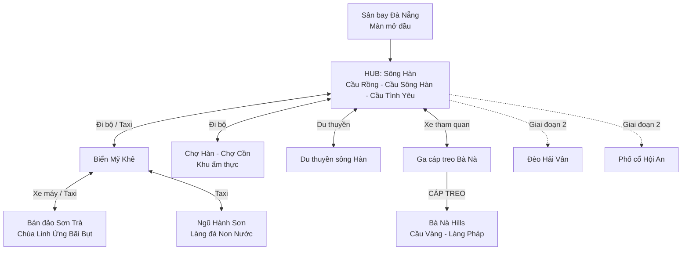
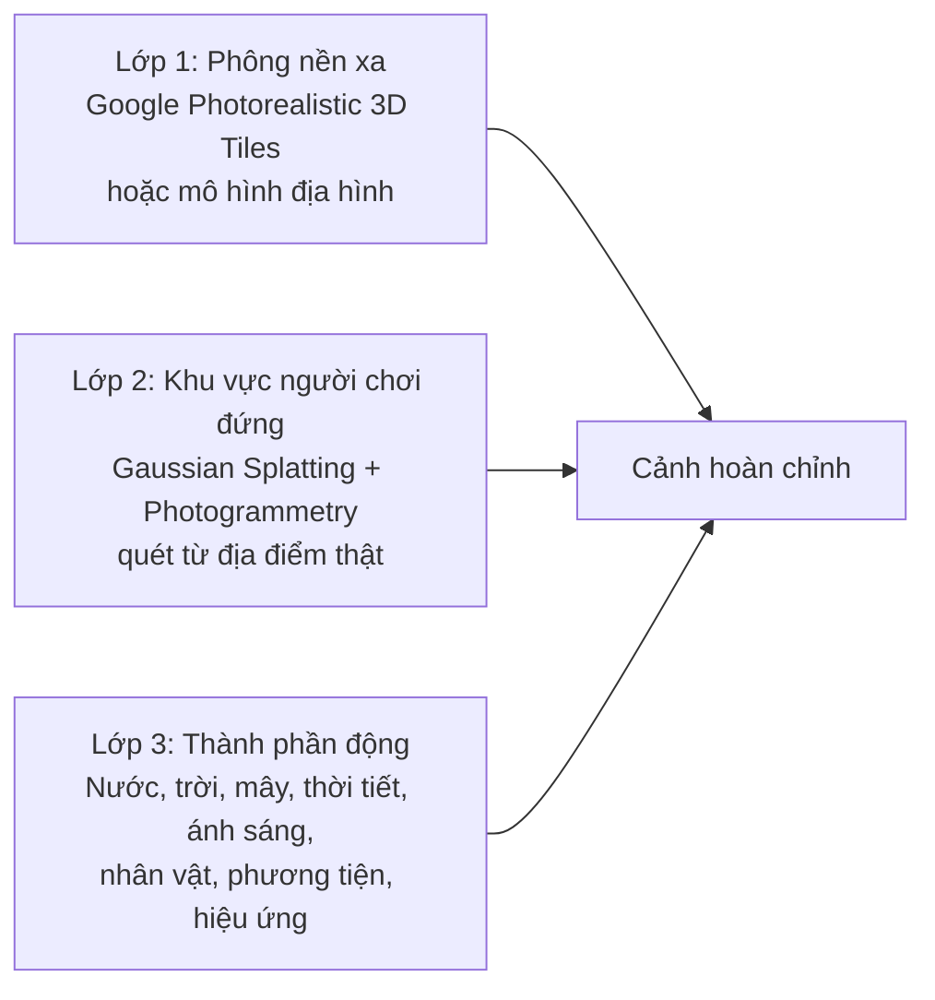
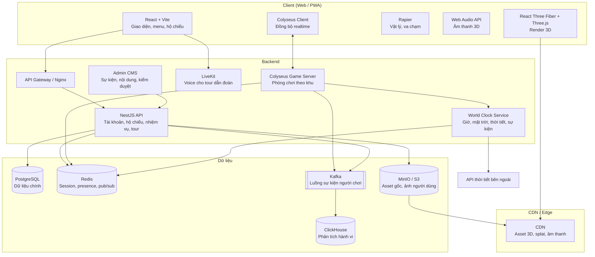
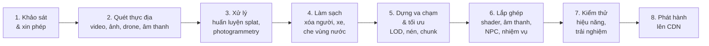
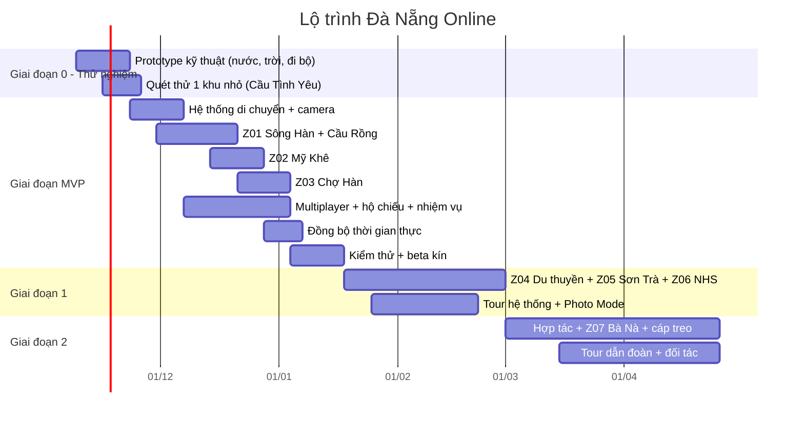

# ĐIỂM ĐẾN #01: ĐÀ NẴNG — Kế hoạch điểm đến thí điểm

> Thuộc nền tảng **Việt Nam Online** (tên tạm). Kiến trúc dùng chung, chuẩn gói điểm đến và chiến lược mở rộng xem tại `00-Ke-hoach-nen-tang.md`; gặp gỡ, nhóm bạn và voice chat xem tại `02-Thiet-ke-choi-cung-nhau-va-voice.md`. Khi có khác biệt, tài liệu nền tảng là chuẩn.
>
> Gói Đà Nẵng nằm trong repo riêng `destination-danang`.
>
> *"Đi Đà Nẵng không cần vé máy bay"*

| Thông tin | Chi tiết |
|---|---|
| Nền tảng | Việt Nam Online (tên tạm) |
| Điểm đến | #01 Đà Nẵng — **điểm đến thí điểm** |
| Mã gói | `danang` |
| Loại sản phẩm | Gói điểm đến trên nền tảng du lịch ảo 3D (Web + PWA), nhiều người chơi |
| Phiên bản tài liệu | v2.0 (định vị lại là điểm đến thí điểm của nền tảng đa điểm đến) |
| Trạng thái | Lên kế hoạch |
| Người phụ trách | AnhNX |

---

## Mục lục

1. [Tổng quan dự án](#1-tổng-quan-dự-án)
2. [Nguyên tắc thiết kế trải nghiệm](#2-nguyên-tắc-thiết-kế-trải-nghiệm)
3. [Bản đồ thế giới và cấu trúc khu vực](#3-bản-đồ-thế-giới-và-cấu-trúc-khu-vực)
4. [Hệ thống di chuyển và điều khiển](#4-hệ-thống-di-chuyển-và-điều-khiển)
5. [Kịch bản phân cảnh chi tiết](#5-kịch-bản-phân-cảnh-chi-tiết)
6. [Thiết kế các tour du lịch](#6-thiết-kế-các-tour-du-lịch)
7. [Hệ thống gameplay và giữ chân người dùng](#7-hệ-thống-gameplay-và-giữ-chân-người-dùng)
8. [Đồng bộ với Đà Nẵng thật](#8-đồng-bộ-với-đà-nẵng-thật)
9. [Công nghệ để đạt độ chân thật cao nhất](#9-công-nghệ-để-đạt-độ-chân-thật-cao-nhất)
10. [Kiến trúc hệ thống](#10-kiến-trúc-hệ-thống)
11. [Quy trình sản xuất nội dung (Content Pipeline)](#11-quy-trình-sản-xuất-nội-dung-content-pipeline)
12. [Hiệu năng và hỗ trợ thiết bị](#12-hiệu-năng-và-hỗ-trợ-thiết-bị)
13. [Mô hình kinh doanh](#13-mô-hình-kinh-doanh)
14. [Pháp lý và rủi ro](#14-pháp-lý-và-rủi-ro)
15. [Lộ trình triển khai](#15-lộ-trình-triển-khai)
16. [Đội ngũ và ngân sách ước tính](#16-đội-ngũ-và-ngân-sách-ước-tính)
17. [KPI và đo lường](#17-kpi-và-đo-lường)
18. [Phụ lục](#18-phụ-lục)

---

## 1. Tổng quan dự án

### 1.1. Bối cảnh

Cuối tháng 10/2026, trào lưu "đi chùa online" (khởi nguồn từ chùa ảo Sansa ở Hàn Quốc, sau đó lan sang Việt Nam với các sản phẩm như Niệm Phật Online) cho thấy người dùng sẵn sàng dành thời gian cho các **không gian 3D mô phỏng địa điểm thật**, có **phòng chơi nhiều người**, **nhiệm vụ tích điểm**, và **dễ livestream**. Đồng thời, trào lưu này cũng bị chỉ trích vì thương mại hóa quá đà (ép xem quảng cáo, nạp tiền "công đức").

Nền tảng Việt Nam Online tận dụng hành vi người dùng đã được kiểm chứng đó, nhưng đặt vào một chủ đề trung tính, tích cực và có giá trị kinh tế thật: **du lịch**. Mục tiêu dài hạn là nhiều điểm đến (Nha Trang, Phú Quốc, Sapa, Hạ Long, Hội An…); Đà Nẵng được làm trước để kiểm chứng sản phẩm và xây phần lõi dùng chung.

### 1.2. Mục tiêu

| Mục tiêu | Mô tả |
|---|---|
| Trải nghiệm | Người dùng có cảm giác "vừa đi Đà Nẵng về" sau một phiên chơi 20–40 phút |
| Chân thật | Hình ảnh, âm thanh, thời tiết, ánh sáng bám sát địa điểm thật |
| Cộng đồng | Nhiều người cùng có mặt, cùng xem sự kiện (Cầu Rồng phun lửa, bình minh Mỹ Khê) |
| Chuyển đổi | Dẫn người dùng từ du lịch ảo sang lên kế hoạch du lịch thật |
| Cá nhân | Sản phẩm portfolio thể hiện năng lực 3D web, realtime, hệ thống phân tán |

### 1.3. Đối tượng người dùng

| Nhóm | Nhu cầu | Cách phục vụ |
|---|---|---|
| Giới trẻ 16–30 tuổi | Giải trí, bắt trend, chia sẻ mạng xã hội | Phòng chơi chung, photo mode, bưu thiếp |
| Người sắp đi Đà Nẵng | Tham khảo, lên lịch trình | Xuất lịch trình thật, thông tin thực tế |
| Người không có điều kiện đi xa | Trải nghiệm thay thế | Tour có thuyết minh, nhịp chậm |
| Người Đà Nẵng xa quê | Hoài niệm | Âm thanh thật, giọng Quảng, ẩm thực |
| Streamer, KOL | Nội dung livestream | Sự kiện theo giờ, tour dẫn đoàn |

### 1.4. Điểm khác biệt (USP)

1. **Đồng bộ thời gian thực**: giờ, mặt trời, thời tiết và sự kiện chạy theo Đà Nẵng thật.
2. **Dữ liệu quét từ địa điểm thật** (Gaussian Splatting, ảnh 360°) thay vì mô hình dựng tay chung chung.
3. **Âm thanh thu tại chỗ** ở từng điểm đến.
4. **Đầy đủ phương tiện**: đi bộ, cáp treo, du thuyền, xe, mỗi loại có cảnh di chuyển riêng.
5. **Cầu nối ra đời thật**: lịch trình, voucher đối tác, thông tin thực tế.
6. **Kiếm tiền sạch**: không ép xem quảng cáo, không bán "may mắn".

### 1.5. Vai trò thí điểm của Đà Nẵng

Đà Nẵng được chọn làm thí điểm vì có gần như đủ mọi loại trải nghiệm (biển, sông, núi mây, cáp treo, hang động, chùa, chợ ẩm thực, sự kiện đêm). Xây xong Đà Nẵng là xây xong phần lớn **Engine** và **bộ Kit** dùng chung cho các điểm đến sau (chi tiết ở tài liệu nền tảng, mục 2 và 5).

**Quy tắc bắt buộc khi làm Đà Nẵng:**

- Không viết tên "Đà Nẵng", "Mỹ Khê", "Cầu Rồng" trong code Engine và Kit. Những thứ đó chỉ nằm trong dữ liệu của gói `destinations/danang/`.
- Mỗi tính năng trong tài liệu này phải được xây thành **kit có tham số**:

| Tính năng ở Đà Nẵng | Được xây thành Kit | Điểm đến sau dùng lại |
|---|---|---|
| Biển Mỹ Khê | `ocean` | Nha Trang, Phú Quốc |
| Sông Hàn | `river` | Hội An, Huế, Hà Nội |
| Cáp treo Bà Nà | `cable-car` | Sapa, Phú Quốc, Nha Trang |
| Du thuyền sông Hàn | `boat` | Hạ Long, Ninh Bình |
| Mây, sương Bà Nà | `mountain-atmosphere` | Sapa, Đà Lạt |
| Hang Ngũ Hành Sơn | `cave` | Hạ Long, Ninh Bình |
| Chùa Linh Ứng | `spiritual-zone` | Huế, Ninh Bình, Hội An |
| Chợ Hàn | `market-food` | Mọi điểm đến |
| Cầu Rồng phun lửa | `scheduled-spectacle` | Pháo hoa, lễ hội các nơi |
| Sân bay Đà Nẵng | `airport` | Mọi điểm đến có sân bay |

**Thí điểm phải trả lời được:** người dùng có thấy giống thật và quay lại không; pipeline quét có chất lượng và chi phí chấp nhận được không; chạy được trên điện thoại tầm trung không; sự kiện thời gian thực có tạo lan truyền không; và **ít nhất 80% code có nằm trong Engine/Kit không**. Tiêu chí đi tiếp sang mở rộng ở tài liệu nền tảng, mục 17.2.

---

## 2. Nguyên tắc thiết kế trải nghiệm

| # | Nguyên tắc | Ý nghĩa thực tế |
|---|---|---|
| 1 | **Âm thanh trước, hình ảnh sau** | Âm thanh thật tạo cảm giác "có mặt" mạnh hơn đồ họa đẹp. Mỗi khu cần ít nhất 3 lớp âm thanh môi trường. |
| 2 | **Hành trình quan trọng như điểm đến** | Không dịch chuyển tức thời giữa các khu ở lần đầu. Ngồi cáp treo, đi thuyền, chạy xe là một phần trải nghiệm. |
| 3 | **Nhịp chậm được phép** | Có chỗ ngồi ngắm cảnh, không bắt làm nhiệm vụ liên tục. Chế độ "Thư giãn" ẩn toàn bộ giao diện. |
| 4 | **Không bao giờ vắng người** | Hiển thị người chơi thật; khi ít người, bổ sung NPC du khách, người bán hàng. |
| 5 | **Mọi thứ có câu chuyện** | Mỗi điểm có thuyết minh ngắn (30–60 giây) bằng giọng người Đà Nẵng. |
| 6 | **Tôn trọng địa điểm** | Khu tâm linh (chùa Linh Ứng, Ngũ Hành Sơn) không có mini game, không bán vật phẩm. |
| 7 | **Chạy được trên điện thoại tầm trung** | Mọi tính năng có phương án chất lượng thấp. |

---

## 3. Bản đồ thế giới và cấu trúc khu vực

### 3.1. Sơ đồ tổng thể



### 3.2. Danh sách khu vực

| Mã | Khu vực | Vai trò | Giai đoạn | Thời lượng gợi ý |
|---|---|---|---|---|
| Z00 | Sân bay Đà Nẵng | Màn mở đầu, tạo nhân vật | MVP | 3–5 phút |
| Z01 | Sông Hàn & Cầu Rồng | Hub trung tâm, sự kiện đêm | MVP | 10–20 phút |
| Z02 | Biển Mỹ Khê | Biển, bình minh, mini game | MVP | 10–20 phút |
| Z03 | Chợ Hàn / Chợ Cồn | Ẩm thực, sưu tầm món ăn | MVP | 10–15 phút |
| Z04 | Du thuyền sông Hàn | Di chuyển + ngắm cảnh | Giai đoạn 1 | 8–12 phút |
| Z05 | Bán đảo Sơn Trà | Thiên nhiên, tâm linh | Giai đoạn 1 | 15–20 phút |
| Z06 | Ngũ Hành Sơn | Hang động, tâm linh, làng nghề | Giai đoạn 1 | 15–25 phút |
| Z07 | Bà Nà Hills | Cáp treo, Cầu Vàng, Làng Pháp | Giai đoạn 2 | 25–40 phút |
| Z08 | Đèo Hải Vân | Cung đường ven biển | Giai đoạn 3 | 10–15 phút |
| Z09 | Phố cổ Hội An | Đèn lồng, hoa đăng | Giai đoạn 3 | 20–30 phút |

> **Ghi chú:** Bà Nà Hills là khu du lịch tư nhân (Sun World). Khu này cần xin phép trước khi quét dữ liệu và sử dụng hình ảnh, thương hiệu. Xem [mục 14](#14-pháp-lý-và-rủi-ro). Đó là lý do khu này được xếp vào giai đoạn 2.

### 3.3. Cách chia không gian kỹ thuật

Mỗi khu là một **scene độc lập** (load riêng), chia nhỏ tiếp thành **chunk** khoảng 100×100 m để tải dần theo vị trí người chơi. Giữa các khu là **cảnh chuyển tiếp** (cáp treo, xe, thuyền) dùng để che thời gian tải scene tiếp theo.

```
World
├── Z01_SongHan/
│   ├── chunk_cau_rong/
│   ├── chunk_cau_song_han/
│   ├── chunk_cau_tinh_yeu/
│   └── chunk_bach_dang_walk/
├── Z02_MyKhe/
│   ├── chunk_beach_north/
│   └── chunk_beach_south/
└── ...
```

---

## 4. Hệ thống di chuyển và điều khiển

### 4.1. Bảng phím điều khiển (PC)

| Phím | Chức năng |
|---|---|
| `↑` `↓` `←` `→` hoặc `W` `A` `S` `D` | Đi bộ tiến, lùi, sang trái, sang phải |
| `Shift` (giữ) | Chạy nhanh |
| `Ctrl` | Đi chậm, ngắm cảnh |
| `Space` | Nhảy (chỉ ở khu ngoài trời, tắt ở khu tâm linh) |
| Chuột (giữ chuột phải + kéo) | Xoay góc nhìn |
| Cuộn chuột | Phóng to, thu nhỏ camera |
| `V` | Đổi góc nhìn thứ nhất / thứ ba |
| `E` | Tương tác (nói chuyện, ngồi, lên phương tiện, mua món) |
| `F` | Ngồi xuống ghế, bãi cát gần nhất |
| `M` | Mở bản đồ, di chuyển nhanh |
| `P` | Chế độ chụp ảnh (Photo Mode) |
| `H` | Ẩn toàn bộ giao diện (chế độ Thư giãn) |
| `T` | Mở chat |
| `X` (giữ) | Giữ để nói ra xung quanh (voice gần) |
| `Ctrl` + `M` | Bật/tắt mic |
| `N` | Đổi chế độ mic: Nhóm / Xung quanh / Tắt |
| `O` | Mở bảng bạn bè và nhóm |
| `G` | Bánh xe biểu cảm |
| `F8` | Thoát nhanh về điểm an toàn |
| `B` | Mở hộ chiếu du lịch |
| `Esc` | Menu, cài đặt |

### 4.2. Điều khiển trên điện thoại

| Thao tác | Chức năng |
|---|---|
| Joystick ảo góc trái | Di chuyển (đẩy xa = chạy) |
| Vuốt nửa màn hình phải | Xoay góc nhìn |
| Nghiêng điện thoại (con quay hồi chuyển) | Nhìn xung quanh, bật/tắt trong cài đặt |
| Nút ngữ cảnh góc phải | Tương tác, chỉ hiện khi đứng gần vật thể |
| Chụm hai ngón | Phóng to, thu nhỏ |
| Rung nhẹ (Vibration API) | Sóng vỗ, cáp treo qua trụ, pháo hoa nổ |

### 4.3. Các phương tiện di chuyển

#### a) Đi bộ (mặc định)

- Nhân vật có vật lý va chạm (Rapier), đi được trên địa hình dốc, cầu thang, bãi cát.
- Tốc độ: đi 1,4 m/s, chạy 4 m/s (gần với người thật để cảm nhận đúng khoảng cách).
- **Âm thanh bước chân thay đổi theo bề mặt**: cát lún, gạch lát, gỗ, đá hang động, nền xi măng ướt khi mưa.
- **Dấu chân trên cát** ở Mỹ Khê, mờ dần sau khoảng 20 giây hoặc bị sóng xóa.
- Camera có độ lắc nhẹ khi đi (có tùy chọn tắt để tránh chóng mặt).

#### b) Cáp treo Bà Nà (phương tiện chủ lực)

**Cách hoạt động:**

1. Người chơi đến ga đi, xếp hàng (hàng đợi ảo nếu đông người thật), nhấn `E` để lên cabin.
2. Cabin chạy theo đường cong spline dựng từ tọa độ thật của tuyến cáp.
3. Tối đa 6–8 người chơi chung một cabin (một phòng nhỏ), có thể chat, chụp ảnh nhóm.
4. Thời lượng trong game nén còn khoảng 3–5 phút (tuyến thật dài hơn nhiều), có tùy chọn "Đi đủ thời gian thật" cho người thích thư giãn.

**Trải nghiệm trong cabin:**

| Thời điểm | Cảnh | Hiệu ứng |
|---|---|---|
| 0:00 | Rời ga, cabin rung nhẹ | Âm thanh cơ khí, tiếng chuông báo |
| 0:30 | Lướt qua tán rừng | Âm thanh chim, côn trùng, bóng nắng qua lá |
| 1:30 | Qua thác nước | Âm thanh nước đổ to dần rồi nhỏ dần (âm thanh 3D) |
| 2:30 | Đi vào mây | Sương mù dày dần, nhiệt độ hiển thị giảm dần |
| 3:30 | Ra khỏi mây | Bừng sáng, lộ quang cảnh đỉnh núi |
| 4:00 | Qua trụ cáp | Cabin rung, điện thoại rung nhẹ |
| 4:30 | Vào ga đến | Giảm tốc, cửa mở |

**Điều khiển trong cabin:** xoay camera 360° để nhìn ra mọi hướng, `P` để chụp ảnh, `↑` `↓` để đổi chỗ ngồi (góc nhìn khác nhau).

#### c) Du thuyền sông Hàn

- Thuyền chạy tuyến cố định, khởi hành mỗi 10 phút (thời gian trong game).
- Người chơi tự do đi lại trên boong, ngồi ghế, đứng mũi thuyền.
- Buổi tối đi qua dưới gầm cầu Rồng và cầu Sông Hàn, đèn đổi màu phản chiếu xuống nước.
- Có thuyết minh tự động khi đi qua từng cây cầu.

#### d) Xe máy, taxi, xe tham quan

- Xe máy chỉ chạy trên các tuyến được dựng sẵn (đường ven biển Võ Nguyên Giáp, đường lên Sơn Trà) để giới hạn khối lượng dựng đường phố.
- Người chơi điều khiển bằng phím mũi tên. Tốc độ bị giới hạn để giữ tinh thần ngắm cảnh, không phải game đua xe.
- Taxi và xe tham quan là **cảnh di chuyển tự động**: chọn điểm đến, xem cảnh đường phố qua cửa sổ trong 30–60 giây. Đây là lúc tải ngầm scene tiếp theo.

#### e) Di chuyển nhanh (Fast Travel)

- Mở bằng phím `M`.
- **Chỉ mở khóa sau khi đã đến khu đó ít nhất một lần bằng phương tiện thường.** Điều này giữ được cảm giác hành trình mà vẫn tiện cho lần chơi sau.
- Hiệu ứng chuyển cảnh: bay từ trên cao (dùng Google Photorealistic 3D Tiles hoặc bản đồ 3D) rồi hạ xuống điểm đến.

### 4.4. Hệ thống camera

| Chế độ | Khi nào dùng |
|---|---|
| Góc nhìn thứ ba (mặc định) | Đi dạo, khám phá, thấy avatar của mình |
| Góc nhìn thứ nhất | Ngắm cảnh, ở trong cabin, chụp ảnh |
| Camera ghế ngồi | Khi ngồi ngắm biển, tự động lùi xa và chậm dần |
| Camera điện ảnh | Các khoảnh khắc đặc biệt (Cầu Rồng phun lửa, đến Cầu Vàng lần đầu) |
| Camera tự do (Photo Mode) | Chụp ảnh, có chỉnh độ sâu trường ảnh, bộ lọc, giờ trong ngày (chỉ khi chụp) |

---

## 5. Kịch bản phân cảnh chi tiết

Mỗi khu được mô tả theo cấu trúc: **Mô tả → Phân cảnh → Tương tác → Âm thanh → Hiệu ứng hình ảnh → Sự kiện theo thời gian thật → Nhiệm vụ → Nguồn dữ liệu.**

### Z00. Sân bay Đà Nẵng (màn mở đầu)

**Mục tiêu:** tạo cảm giác "bắt đầu chuyến đi", hướng dẫn điều khiển một cách tự nhiên.

| Phân cảnh | Nội dung |
|---|---|
| S00.1 | Màn hình đen, tiếng động cơ máy bay, thông báo của tiếp viên: "Chúng ta chuẩn bị hạ cánh xuống sân bay quốc tế Đà Nẵng…" |
| S00.2 | Nhìn qua cửa sổ máy bay: thành phố, sông Hàn, bờ biển (dùng 3D Tiles), máy bay hạ dần |
| S00.3 | Tạo nhân vật: ngoại hình, trang phục, tên du khách |
| S00.4 | Nhận **Hộ chiếu du lịch** và dấu đầu tiên "Đã đến Đà Nẵng" |
| S00.5 | Ra sảnh đến, hướng dẫn đi bộ bằng phím mũi tên (bước ra cửa) |
| S00.6 | Lên taxi, cảnh đường phố về sông Hàn (cảnh tải scene Z01) |

**Hướng dẫn điều khiển lồng ghép:** không có bảng hướng dẫn dài. Gợi ý xuất hiện theo ngữ cảnh: "Nhấn ↑ để đi tới cửa ra", "Nhấn E để lấy hành lý".

### Z01. Sông Hàn & Cầu Rồng (HUB)

**Mô tả:** khu trung tâm, nơi người chơi xuất hiện mỗi lần đăng nhập. Gồm đoạn bờ đông sông Hàn quanh chân Cầu Rồng, Cầu Tình Yêu, tượng cá chép hóa rồng, và một phần đường Bạch Đằng nhìn sang.

| Phân cảnh | Nội dung | Tương tác |
|---|---|---|
| S01.1 | Điểm xuất hiện ở công viên đầu cầu Rồng | Bảng thông báo sự kiện sắp diễn ra |
| S01.2 | Đi bộ trên cầu Rồng | Ngắm sông, lấy dấu hộ chiếu |
| S01.3 | Cầu Tình Yêu | Treo ổ khóa ảo kèm lời nhắn, xem khóa của người khác |
| S01.4 | Tượng cá chép hóa rồng | Thuyết minh, chụp ảnh |
| S01.5 | Bến du thuyền | Lên thuyền đi Z04 |
| S01.6 | Điểm đón taxi | Đi Mỹ Khê, Ngũ Hành Sơn, ga cáp treo |

**Âm thanh:** tiếng xe cộ xa xa, gió sông, nhạc từ quán cà phê ven sông, tiếng người nói chuyện (trộn tiếng Việt giọng Quảng, tiếng Hàn, tiếng Anh như thực tế).

**Hiệu ứng hình ảnh:**
- Mặt sông có phản chiếu, gợn sóng, ánh đèn kéo dài trên mặt nước ban đêm.
- Đèn LED cầu Rồng đổi màu theo chu kỳ.
- Ban ngày: nắng gắt, bóng đổ rõ. Chiều tối: trời chuyển cam tím phía sau núi.

**Sự kiện theo thời gian thật:**

| Sự kiện | Thời điểm | Chi tiết |
|---|---|---|
| Cầu Rồng phun lửa, phun nước | Tối thứ Bảy, Chủ nhật và dịp lễ, khoảng 21h (theo lịch vận hành thật, cần xác minh định kỳ) | Camera điện ảnh tùy chọn, hiệu ứng lửa (particles + bloom), hơi nước bay vào người xem đứng gần, đếm ngược trước 10 phút, thông báo đẩy cho người đăng ký |
| Cầu Sông Hàn quay | Theo lịch thật (cần xác minh) | Hoạt cảnh cầu xoay |
| Pháo hoa | Theo mùa lễ hội pháo hoa và dịp Tết | Phòng đặc biệt, giới hạn người, xếp hàng ảo |

> Sự kiện phun lửa là **khoảnh khắc viral chính** của sản phẩm: nhiều người online cùng lúc, dễ livestream, dễ cắt clip.

**Nhiệm vụ:**
- "Người bạn đầu tiên": chào hỏi một người chơi khác.
- "Lời hẹn trên cầu": treo một ổ khóa ở Cầu Tình Yêu.
- "Rồng thức giấc": có mặt khi Cầu Rồng phun lửa.

**Nguồn dữ liệu:** Gaussian Splatting cho khu Cầu Tình Yêu và tượng cá chép; mô hình 3D dựng từ bản vẽ và ảnh cho thân cầu Rồng (vật thể lớn, cần hoạt cảnh); 3D Tiles cho phông nền thành phố xa.

### Z02. Biển Mỹ Khê

**Mô tả:** đoạn bãi biển dài khoảng 1 km, có hàng dừa, chòi cứu hộ, thúng chai, quán hải sản ven bờ. Nhìn ra xa thấy bán đảo Sơn Trà và tượng Quan Âm.

| Phân cảnh | Nội dung | Tương tác |
|---|---|---|
| S02.1 | Lối xuống biển từ đường Võ Nguyên Giáp | Chuyển âm thanh từ phố sang biển |
| S02.2 | Bãi cát | Đi chân trần, để lại dấu chân, ngồi trên cát |
| S02.3 | Mép nước | Sóng tràn tới chân, nhân vật ướt chân (shader ướt) |
| S02.4 | Ghế dù, chòi | Nằm ngắm biển (chế độ Thư giãn) |
| S02.5 | Thúng chai của ngư dân | Nói chuyện với NPC ngư dân, nghe chuyện nghề biển |
| S02.6 | Khu mini game | Xây lâu đài cát, thả diều, bóng chuyền bãi biển (nhiều người) |

**Âm thanh:** sóng vỗ thu tại chỗ (âm lượng theo khoảng cách tới mép nước), gió biển, tiếng mòng biển, tiếng trẻ con chơi, tiếng rao bán xa xa.

**Hiệu ứng hình ảnh:**
- **Nước biển:** shader sóng nhiều lớp (Gerstner waves), vùng nước nông màu xanh ngọc, ra xa xanh đậm, bọt sóng ở bờ, nước tràn lên cát rồi rút để lại vệt cát ướt.
- **Bầu trời vật lý:** vị trí mặt trời tính chính xác theo tọa độ Đà Nẵng.
- **Bình minh:** mặt trời mọc từ phía biển (đúng thực tế bờ biển hướng đông), vệt nắng vàng trên mặt nước.
- Dừa lay theo gió (vertex shader), cường độ gió lấy từ API thời tiết.

**Sự kiện theo thời gian thật:**
- **Bình minh Mỹ Khê** (theo giờ mặt trời mọc thật): tặng dấu hộ chiếu đặc biệt "Người đón bình minh". Đây là sự kiện thứ hai sau Cầu Rồng có khả năng tạo thói quen quay lại.
- Thủy triều, độ cao sóng theo dữ liệu thực (nếu có nguồn dữ liệu phù hợp).
- Mưa, giông thật: bãi biển vắng NPC, có thông báo "Biển đang động".

**Nhiệm vụ:**
- "Người đón bình minh": có mặt ở biển lúc mặt trời mọc.
- "Kiến trúc sư cát": xây một lâu đài cát.
- "Chuyện của biển": nghe hết câu chuyện của ngư dân.

**Nguồn dữ liệu:** Gaussian Splatting cho hàng dừa, chòi cứu hộ, thúng chai; mặt nước và bầu trời làm hoàn toàn bằng shader (splatting không xử lý tốt nước chuyển động); địa hình cát dựng từ dữ liệu độ cao.

### Z03. Chợ Hàn & Chợ Cồn (khu ẩm thực)

**Mô tả:** không gian chợ trong nhà với các sạp đồ khô, đặc sản, và khu ăn uống. Đây là khu "sưu tầm" chính.

| Phân cảnh | Nội dung | Tương tác |
|---|---|---|
| S03.1 | Cổng chợ | Tiếng ồn tăng dần khi bước vào |
| S03.2 | Dãy sạp đặc sản | NPC mời mua, xem thông tin đặc sản (mực rim, chả bò, nước mắm Nam Ô) |
| S03.3 | Khu ăn uống | Gọi món, xem hoạt cảnh chế biến, nhận thẻ món ăn |
| S03.4 | Bàn ăn chung | Ngồi cùng người chơi khác |

**Bộ sưu tập món ăn (giai đoạn đầu):**

| Món | Nội dung thẻ |
|---|---|
| Mì Quảng | Nguồn gốc, cách ăn, gợi ý quán thật (đối tác) |
| Bánh tráng cuốn thịt heo | Cách cuốn (mini game cuốn bánh) |
| Bún chả cá | Đặc trưng chả cá Đà Nẵng |
| Bún mắm nêm | Giới thiệu mắm nêm |
| Gỏi cá Nam Ô | Làng chài Nam Ô |
| Bánh xèo | Cách ăn với rau sống và nước chấm |
| Chè | Các loại chè địa phương |
| Hải sản | Ốc, ghẹ, mực |

**Âm thanh:** tiếng rao bằng giọng Quảng, tiếng mặc cả, tiếng chảo xèo, tiếng bát đũa.

**Hiệu ứng:** hơi nóng bốc lên từ nồi nước dùng (particles), ánh đèn vàng ấm, khói nướng.

**Nhiệm vụ:** "Thổ địa ẩm thực" (sưu tầm đủ 8 món), "Người sành ăn" (ăn món đặc trưng ở mỗi khu).

**Nguồn dữ liệu:** Gaussian Splatting cho các sạp hàng (cần xin phép ban quản lý chợ và tiểu thương); món ăn dựng bằng photogrammetry chụp món thật.

### Z04. Du thuyền sông Hàn

**Mô tả:** tuyến thuyền xuôi sông Hàn, đi qua các cây cầu biểu tượng.

| Phân cảnh | Nội dung |
|---|---|
| S04.1 | Lên thuyền ở bến, chọn chỗ ngồi |
| S04.2 | Đi qua cầu Rồng (thuyết minh kiến trúc) |
| S04.3 | Đi qua cầu Sông Hàn (thuyết minh câu chuyện cầu quay) |
| S04.4 | Hướng về cầu Trần Thị Lý và cầu Thuận Phước (nhìn xa) |
| S04.5 | Quay đầu về bến |

**Đặc biệt:** chuyến đêm có đèn phản chiếu và nhạc acoustic trên boong. Có phòng thuyền "riêng" cho nhóm bạn (tối đa 10 người).

### Z05. Bán đảo Sơn Trà

**Mô tả:** cung đường núi rừng ven biển, chùa Linh Ứng Bãi Bụt với tượng Quan Âm nhìn ra vịnh, khu rừng có voọc chà vá chân nâu.

| Phân cảnh | Nội dung | Tương tác |
|---|---|---|
| S05.1 | Đường lên núi bằng xe máy | Điều khiển xe theo tuyến đường ven biển |
| S05.2 | Chùa Linh Ứng Bãi Bụt | Đi bộ trong sân chùa, ngắm tượng Quan Âm, thắp hương (khu tâm linh) |
| S05.3 | Điểm nhìn vịnh | Ngắm toàn cảnh thành phố và biển |
| S05.4 | Rừng nguyên sinh | Đi bộ tìm voọc chà vá chân nâu |
| S05.5 | Cây đa cổ thụ | Thuyết minh về cây |
| S05.6 | Đỉnh Bàn Cờ | Truyền thuyết tiên đánh cờ, view toàn cảnh |

**Quy tắc khu tâm linh (chùa Linh Ứng):**
- Tắt nhảy, tắt chạy (tự động chuyển sang đi chậm).
- Voice gần ở chế độ thì thầm (bán kính khoảng 6 m), voice nhóm vẫn hoạt động (cấu hình `social` theo tài liệu 02, mục 16).
- Không có mini game, không bán vật phẩm, không hiển thị quảng cáo.
- Chat chuyển sang chế độ hạn chế.
- Hoạt động thắp hương chỉ mang tính tưởng niệm, **không gắn điểm thưởng, không gắn tiền.**

**Nhiệm vụ "Người bảo vệ rừng":** tìm và quan sát voọc (không được lại gần quá, đi quá gần voọc sẽ chạy mất). Lồng ghép thông điệp bảo tồn loài quý hiếm.

**Âm thanh:** tiếng chuông chùa, tiếng mõ xa, tiếng rừng, gió núi.

**Nguồn dữ liệu:** Gaussian Splatting cho sân chùa và tượng (cần xin phép nhà chùa); địa hình núi từ dữ liệu độ cao kết hợp 3D Tiles; cây cối dùng instancing.

### Z06. Ngũ Hành Sơn & Làng đá Non Nước

**Mô tả:** cụm năm ngọn núi đá vôi (Kim, Mộc, Thủy, Hỏa, Thổ). Trọng tâm là Thủy Sơn với hệ thống hang động, chùa và các điểm nhìn.

| Phân cảnh | Nội dung | Tương tác |
|---|---|---|
| S06.1 | Chân núi, cầu thang đá lên Thủy Sơn | Leo bậc thang (camera nghiêng lên, tiếng thở nhẹ) |
| S06.2 | Chùa Tam Thai | Khu tâm linh |
| S06.3 | Động Huyền Không | Ánh sáng xuyên qua lỗ trần hang (hiệu ứng tia sáng thể tích) |
| S06.4 | Động Âm Phủ | Hang tối, cần đèn pin (nhân vật bật đèn tự động), thuyết minh truyền thuyết |
| S06.5 | Vọng Giang Đài, Vọng Hải Đài | Điểm nhìn ra sông và biển |
| S06.6 | Làng đá Non Nước | Xem nghệ nhân khắc đá, mini game tạc tượng nhỏ làm kỷ vật |

**Hiệu ứng hình ảnh quan trọng:**
- **Tia sáng thể tích (God rays)** trong động Huyền Không: đây là cảnh "đinh" về hình ảnh của khu này.
- Bụi lơ lửng trong ánh sáng, hơi ẩm trên vách đá.
- Hang tối với ánh đèn pin động, bóng đổ mềm.

**Âm thanh:** tiếng vang trong hang (reverb), nước nhỏ giọt, tiếng đục đá ở làng nghề.

**Nguồn dữ liệu:** Gaussian Splatting rất phù hợp cho hang động (cấu trúc phức tạp, khó dựng tay); làng đá dùng photogrammetry cho các tượng đá.

### Z07. Bà Nà Hills (giai đoạn 2, cần hợp tác)

**Mô tả:** khu du lịch trên đỉnh núi, khí hậu mát, gồm hệ thống cáp treo, Cầu Vàng với đôi bàn tay khổng lồ, Làng Pháp, vườn hoa, hầm rượu Debay.

| Phân cảnh | Nội dung | Tương tác |
|---|---|---|
| S07.1 | Xe tham quan từ trung tâm lên chân núi | Cảnh di chuyển, tải scene |
| S07.2 | Ga cáp treo | Xếp hàng ảo, lên cabin |
| S07.3 | **Đi cáp treo** | Xem chi tiết [mục 4.3.b](#b-cáp-treo-bà-nà-phương-tiện-chủ-lực) |
| S07.4 | **Cầu Vàng** | Lần đầu đặt chân: camera điện ảnh lùi xa, nhạc nền, sương mây bay qua đôi bàn tay |
| S07.5 | Vườn hoa | Đi dạo, hoa nở theo mùa thật |
| S07.6 | Làng Pháp | Kiến trúc châu Âu, quảng trường, nhà thờ, nhạc đường phố |
| S07.7 | Hầm rượu | Không gian tối, mát, ánh đèn vàng |
| S07.8 | Cáp treo xuống núi | Có thể chọn tuyến khác |

**Đặc trưng:** thời tiết trên núi khác hẳn dưới thành phố. Hệ thống thời tiết riêng cho khu núi: sương mù dày đặc, mây trôi ngang tầm mắt, nhiệt độ hiển thị thấp hơn khoảng 6–8°C so với thành phố. Hiệu ứng "một ngày bốn mùa": sáng sương, trưa nắng, chiều mưa phùn, tối lạnh.

**Hiệu ứng chủ chốt:** mây thể tích (volumetric clouds) bay qua Cầu Vàng; đây là hình ảnh nhận diện của cả dự án.

**Nhiệm vụ:** "Chạm tới mây" (đi cáp treo lần đầu), "Bàn tay của núi" (chụp ảnh ở Cầu Vàng khi có mây).

### Z08, Z09. Đèo Hải Vân & Phố cổ Hội An (giai đoạn 3)

- **Đèo Hải Vân:** cung đường lái xe máy ven biển, điểm dừng Hải Vân Quan, sương núi. Phù hợp làm "cung đường phượt ảo".
- **Phố cổ Hội An:** đèn lồng, thả hoa đăng trên sông Hoài buổi tối, Chùa Cầu. Sau khi sáp nhập hành chính năm 2025, Hội An thuộc TP Đà Nẵng, nên đây là phần mở rộng tự nhiên của dự án.

---

## 6. Thiết kế các tour du lịch

Ngoài khám phá tự do, người chơi có thể chọn **tour có hướng dẫn**. Tour do hệ thống dẫn (NPC hướng dẫn viên kèm thuyết minh) hoặc do người thật dẫn (hướng dẫn viên, streamer).

### 6.1. Tour "Một ngày Đà Nẵng" (khoảng 45 phút)

| Thứ tự | Điểm đến | Phương tiện | Thời lượng | Điểm nhấn |
|---|---|---|---|---|
| 1 | Sân bay | Máy bay | 3 phút | Hạ cánh |
| 2 | Biển Mỹ Khê | Taxi | 10 phút | Tắm biển, xây lâu đài cát |
| 3 | Chợ Hàn | Taxi | 10 phút | Ăn mì Quảng, bánh tráng cuốn |
| 4 | Sông Hàn | Đi bộ | 7 phút | Cầu Tình Yêu, treo khóa |
| 5 | Du thuyền đêm | Thuyền | 10 phút | Ngắm đèn các cây cầu |
| 6 | Cầu Rồng | Đi bộ | 5 phút | Xem phun lửa (nếu đúng giờ) hoặc bản phát lại |

### 6.2. Tour "Ba ngày hai đêm" (chơi qua 3 phiên, mỗi phiên 30–40 phút)

| Ngày | Chủ đề | Lộ trình |
|---|---|---|
| Ngày 1 | Biển và thành phố | Sân bay → Mỹ Khê → Chợ Hàn → Sông Hàn về đêm |
| Ngày 2 | Núi mây | Xe lên Bà Nà → Cáp treo → Cầu Vàng → Làng Pháp → Cáp treo xuống |
| Ngày 3 | Thiên nhiên và tâm linh | Bình minh Mỹ Khê → Sơn Trà (chùa Linh Ứng, voọc) → Ngũ Hành Sơn → Làng đá → Ra sân bay |

Khi hoàn thành tour, người chơi nhận **bưu thiếp tổng kết hành trình**: bản đồ lộ trình đã đi, ảnh đã chụp, món đã ăn, số km đã đi bộ. Bưu thiếp này được thiết kế để chia sẻ lên mạng xã hội.

### 6.3. Tour theo chủ đề

| Tour | Nội dung | Thời điểm khuyến nghị |
|---|---|---|
| Đón bình minh | Mỹ Khê lúc mặt trời mọc → Sơn Trà | Sáng sớm (theo giờ thật) |
| Đà Nẵng về đêm | Du thuyền → Cầu Rồng phun lửa → Cầu Sông Hàn | Tối cuối tuần |
| Ẩm thực | Chợ Hàn → Chợ Cồn → quán hải sản ven biển | Bất kỳ lúc nào |
| Tâm linh, an yên | Chùa Linh Ứng → Ngũ Hành Sơn (không gian yên tĩnh, không chat) | Bất kỳ lúc nào |
| Bảo tồn thiên nhiên | Sơn Trà tìm voọc → rừng → biển | Ban ngày |

### 6.4. Tour do người thật dẫn

- Hướng dẫn viên du lịch thật hoặc streamer tạo "đoàn" (tối đa 30–50 người).
- Người trong đoàn được **dịch chuyển theo trưởng đoàn** khi chuyển khu.
- Trưởng đoàn có kênh voice (WebRTC) và quyền phát thuyết minh.
- Đây là hướng hợp tác với các công ty lữ hành: dùng tour ảo để giới thiệu tour thật.

---

## 7. Hệ thống gameplay và giữ chân người dùng

### 7.1. Hộ chiếu du lịch

- Mỗi điểm đến có **con dấu riêng** (thiết kế theo phong cách tem bưu chính).
- Có dấu thường (đến nơi) và dấu đặc biệt (đúng sự kiện: bình minh, phun lửa, mưa trên Bà Nà).
- Hoàn thành bộ dấu một khu thì mở danh hiệu.

| Danh hiệu | Điều kiện |
|---|---|
| Du khách mới | Hoàn thành màn mở đầu |
| Người yêu biển | Đủ dấu khu Mỹ Khê + bình minh |
| Thổ địa ẩm thực | Sưu tầm đủ 8 món |
| Người chạm mây | Đi cáp treo + Cầu Vàng khi có mây |
| Thổ địa Đà Nẵng | Đủ dấu tất cả các khu |

### 7.2. Nhiệm vụ

| Loại | Ví dụ | Phần thưởng |
|---|---|---|
| Nhiệm vụ chính | Chuỗi nhiệm vụ của từng khu | Dấu hộ chiếu, mở khu mới |
| Nhiệm vụ hằng ngày | Ghé 3 điểm, chào 1 người chơi | Điểm kinh nghiệm, vật phẩm trang trí |
| Nhiệm vụ sự kiện | Có mặt khi Cầu Rồng phun lửa | Dấu đặc biệt |
| Đố vui văn hóa | Câu hỏi về lịch sử, ẩm thực | Bưu thiếp hiếm |
| Nhiệm vụ ẩn | Tìm vật thể giấu trong map | Danh hiệu hiếm |

> **Nguyên tắc:** không có nhiệm vụ "xem quảng cáo". Không gắn điểm thưởng vào hoạt động tâm linh.

### 7.3. Tính năng xã hội

- Chat theo khu (giới hạn bán kính), chat nhóm, chat riêng.
- Biểu cảm (vẫy tay, chụp ảnh tự sướng, ngồi, nhảy múa ở khu phù hợp).
- Kết bạn, xem bạn bè đang ở khu nào, dịch chuyển tới bạn.
- Ổ khóa tình yêu, sổ lưu bút ở mỗi điểm đến (có kiểm duyệt nội dung).

### 7.4. Chế độ chụp ảnh (Photo Mode)

- Camera tự do trong bán kính giới hạn quanh nhân vật.
- Chỉnh: tiêu cự, độ sâu trường ảnh, độ phơi sáng, bộ lọc màu.
- Khung bưu thiếp có logo, tên địa điểm, ngày giờ thật.
- Xuất ảnh chất lượng cao (render lại ở độ phân giải gấp đôi).
- Chia sẻ thẳng lên Facebook, TikTok, Zalo.

### 7.5. Cầu nối ra du lịch thật

- **"Biến chuyến đi ảo thành thật":** từ các điểm đã ghé, xuất lịch trình thật (thứ tự điểm đến, thời gian di chuyển ước tính, gợi ý thời điểm đẹp).
- Thông tin thực tế ở mỗi điểm: giờ mở cửa, giá vé tham khảo (lấy từ nguồn chính thức, cập nhật định kỳ), cách đi.
- Voucher từ đối tác (quán ăn, khách sạn) khi hoàn thành nhiệm vụ.

---

## 8. Đồng bộ với Đà Nẵng thật

Đây là tính năng tạo khác biệt lớn nhất. Toàn bộ dựa trên một **"đồng hồ thế giới"** đặt ở máy chủ.

| Dữ liệu | Nguồn | Tần suất | Ảnh hưởng trong game |
|---|---|---|---|
| Giờ địa phương | Máy chủ (múi giờ UTC+7) | Liên tục | Ngày đêm, NPC (chợ đóng cửa ban đêm) |
| Vị trí mặt trời, mặt trăng | Thư viện SunCalc theo tọa độ Đà Nẵng | Mỗi phút | Hướng nắng, bóng đổ, màu trời, pha mặt trăng |
| Thời tiết | API thời tiết (OpenWeatherMap hoặc tương đương) | 10–15 phút | Mưa, mây, gió, nhiệt độ hiển thị |
| Lịch sự kiện | Bảng cấu hình do admin cập nhật | Theo lịch | Cầu Rồng phun lửa, pháo hoa, lễ hội |
| Ngày lễ âm lịch | Thư viện lịch âm | Hằng ngày | Trang trí Tết, Trung thu, rằm |
| Mùa | Theo tháng | Hằng ngày | Hoa nở trên Bà Nà, lượng khách NPC |

**Chế độ "Giờ tự chọn":** người dùng ở múi giờ khác, hoặc muốn xem cảnh đêm vào ban ngày, có thể bật thời gian tùy chọn. Khi đó họ vào **phòng riêng** (không gặp người khác) để không phá trải nghiệm chung. Phòng công cộng luôn chạy theo giờ thật.

**Bản phát lại sự kiện:** người bỏ lỡ Cầu Rồng phun lửa có thể xem bản phát lại trong phòng riêng, nhưng không nhận dấu đặc biệt (giữ giá trị của việc có mặt đúng giờ).

---

## 9. Công nghệ để đạt độ chân thật cao nhất

### 9.1. Chiến lược tổng thể: kết hợp ba lớp



| Lớp | Công nghệ | Lý do |
|---|---|---|
| Phông nền xa | Google Photorealistic 3D Tiles (qua 3DTilesRendererJS hoặc CesiumJS) | Có sẵn toàn cảnh thành phố, nhìn xa rất thật. Nhìn gần bị vỡ nên chỉ dùng cho phông nền và cảnh bay. Cần kiểm tra độ phủ dữ liệu tại Đà Nẵng và tuân thủ điều khoản (ghi nguồn, hạn chế lưu trữ). |
| Khu người chơi đứng | **3D Gaussian Splatting** | Tái tạo cảnh gần như ảnh chụp từ video quay điện thoại hoặc máy ảnh. Phù hợp nhất cho chùa, hang động, chợ, hàng dừa. |
| Vật thể cần tương tác | Photogrammetry ra mesh (glTF) | Splatting không có va chạm vật lý và khó hoạt cảnh, nên vật thể cần chạm, ngồi, di chuyển phải là mesh. |
| Thành phần động | Shader, particles, vật lý | Nước, trời, mây, mưa không quét được, phải mô phỏng bằng code. |

### 9.2. Gaussian Splatting: lưu ý khi dùng

| Vấn đề | Giải pháp |
|---|---|
| Splat không có va chạm | Dựng **mesh va chạm ẩn** đơn giản (sàn, tường, cầu thang) đặt khớp bên dưới splat |
| Splat không nhận ánh sáng động | Quét vào lúc ánh sáng trung tính (trời nhiều mây), sau đó chỉnh màu splat theo giờ trong game bằng shader (color grading theo thời gian) |
| Dung lượng lớn | Nén (định dạng SPZ hoặc tương đương, giảm bậc spherical harmonics), chia chunk, tải theo khoảng cách |
| Người, xe lọt vào lúc quét | Quét sáng sớm khi vắng, dùng công cụ xóa vùng trong phần mềm xử lý |
| Mặt nước bị lỗi | Che vùng nước khi quét, thay bằng shader nước |

**Công cụ tham khảo:** quét bằng điện thoại (Polycam, Scaniverse, Luma AI) hoặc máy ảnh/drone kết hợp phần mềm huấn luyện splat trên máy tính (Postshot, gsplat, Nerfstudio). Hiển thị trên web bằng thư viện splat cho Three.js (Spark, GaussianSplats3D…). Cần đánh giá lại các công cụ này tại thời điểm triển khai vì lĩnh vực thay đổi rất nhanh.

### 9.3. Kỹ thuật mô phỏng môi trường

| Thành phần | Kỹ thuật |
|---|---|
| Nước biển | Gerstner waves nhiều tầng, phản chiếu (planar reflection hoặc screen-space), khúc xạ, màu theo độ sâu, foam ở bờ theo depth buffer, sóng tràn cát bằng shader cát ướt |
| Nước sông | Normal map động, phản chiếu ánh đèn đêm kéo dài |
| Bầu trời | Mô hình bầu trời vật lý (atmospheric scattering, như Sky của Three.js hoặc Preetham/Hosek-Wilkie) |
| Mây | Mây thể tích (raymarching) cho Bà Nà; mây 2D nhiều lớp cho khu khác để tiết kiệm |
| Sương mù | Height fog + volumetric fog ở núi |
| Mưa | Particles GPU, vệt nước trên camera, mặt đất ướt phản chiếu, gợn nước trên vũng |
| Ánh sáng | Image Based Lighting theo thời gian trong ngày, bóng đổ cascaded shadow maps |
| Tia sáng trong hang | God rays (volumetric light) |
| Cây cối | Instancing, lay theo gió bằng vertex shader |
| Lửa Cầu Rồng | Particles GPU + bloom + ánh sáng chiếu lên mặt nước |
| Hậu kỳ | Tone mapping (ACES/AgX), bloom, SSAO, color grading, depth of field cho Photo Mode |

### 9.4. Âm thanh

| Kỹ thuật | Ứng dụng |
|---|---|
| Thu âm tại chỗ (field recording) | Mỗi khu ít nhất 3 lớp: nền xa, nền gần, điểm nhấn |
| Âm thanh không gian 3D (Web Audio API, PannerNode, HRTF) | Tiếng sóng, thác nước, quầy hàng có hướng và khoảng cách |
| Vùng âm thanh (audio zones) | Chuyển mượt giữa phố và biển, ngoài và trong hang |
| Reverb theo không gian | Hang động, hầm rượu, trong chùa |
| Âm thanh theo bề mặt | Bước chân cát, gỗ, đá, gạch |
| Thuyết minh | Giọng người Đà Nẵng thật thu âm, hoặc giọng tổng hợp chất lượng cao (cần đồng ý của người cho giọng) |

### 9.5. Nhân vật và NPC

- Avatar tùy biến (định dạng glTF, bộ xương chuẩn để dùng chung hoạt cảnh).
- Hoạt cảnh: đi, chạy, ngồi, vẫy tay, chụp ảnh, bơi lội nông.
- NPC du khách có lịch trình đơn giản (đi dạo, ngồi, chụp ảnh), mật độ theo giờ và thời tiết thật.
- NPC tương tác (ngư dân, người bán hàng, hướng dẫn viên) có hội thoại cố định; giai đoạn sau có thể dùng mô hình ngôn ngữ để trả lời câu hỏi về địa điểm (cần giới hạn nội dung, chỉ trả lời trong phạm vi thông tin đã kiểm duyệt).

---

## 10. Kiến trúc hệ thống

> Kiến trúc dưới đây áp dụng cho giai đoạn thí điểm. Kiến trúc đa điểm đến (Destination Registry, Destination Loader, tải động Kit, phân vùng phòng theo điểm đến, World Clock đa điểm) ở tài liệu nền tảng, mục 6. Ngay từ thí điểm: mọi bảng dữ liệu có `destination_id`, khóa phòng có dạng `danang:<zone>:<shard>`, World Clock đọc tọa độ và nguồn thời tiết từ manifest.

### 10.1. Sơ đồ tổng quan



### 10.2. Bảng công nghệ

| Tầng | Công nghệ | Vai trò |
|---|---|---|
| Frontend | React, Vite, TypeScript | Khung ứng dụng |
| Giao diện | TailwindCSS, Zustand (state) | UI, menu, HUD |
| Render 3D | Three.js, React Three Fiber, @react-three/drei | Dựng cảnh |
| Hậu kỳ | pmndrs/postprocessing | Bloom, tone mapping, DOF |
| Vật lý | Rapier (@react-three/rapier) | Va chạm, di chuyển nhân vật |
| Gaussian Splatting | Thư viện splat cho Three.js | Hiển thị cảnh quét |
| Bản đồ 3D | 3DTilesRendererJS hoặc CesiumJS, Google Map Tiles API | Phông nền xa, cảnh bay |
| Âm thanh | Web Audio API, Howler.js | Âm thanh 3D |
| Điều khiển mobile | Joystick ảo (nipplejs hoặc tự viết), DeviceOrientation API | Di chuyển, nhìn |
| Thiên văn | SunCalc | Vị trí mặt trời, mặt trăng |
| Realtime | Colyseus (Node.js) | Phòng chơi, đồng bộ vị trí |
| Voice | LiveKit (WebRTC) | Thuyết minh trực tiếp |
| Backend API | NestJS | Nghiệp vụ |
| CSDL | PostgreSQL | Tài khoản, hộ chiếu, nhiệm vụ |
| Cache, presence | Redis | Ai đang ở đâu, pub/sub giữa các server |
| Luồng sự kiện | Kafka | Ghi nhận hành vi người chơi |
| Phân tích | ClickHouse | Dashboard hành vi, heatmap di chuyển |
| Lưu trữ | MinIO (S3) + CDN | Asset 3D, ảnh chụp |
| Quan sát hệ thống | OpenTelemetry, Grafana | Log, trace, metric |
| Triển khai | Docker, Jenkins hoặc Bitbucket Pipelines | CI/CD |
| Công cụ 3D | Blender, phần mềm xử lý splat | Dựng và tối ưu asset |
| Nén asset | glTF + Draco/Meshopt, KTX2 (Basis), SPZ cho splat | Giảm dung lượng |
| Tương lai | WebGPU (Three.js WebGPURenderer), WebXR | Đồ họa cao hơn, kính VR |

### 10.3. Thiết kế phòng chơi realtime

- **Một phòng = một khu (hoặc một chunk của khu lớn)**, giới hạn khoảng 50–100 người/phòng. Khi đầy, tự tạo phòng song song ("Mỹ Khê #2").
- Phòng đặc biệt cho sự kiện (Cầu Rồng phun lửa) có thể tăng giới hạn bằng cách chỉ đồng bộ người ở gần, người ở xa hiển thị dạng đơn giản.
- **Tần suất đồng bộ:** vị trí 10–15 lần/giây, client nội suy (interpolation) để chuyển động mượt.
- **Server có thẩm quyền** với các hành động quan trọng (nhận dấu, hoàn thành nhiệm vụ) để chống gian lận.
- **Interest management:** chỉ gửi dữ liệu những người trong bán kính nhìn thấy.
- Redis pub/sub để nhiều tiến trình Colyseus đồng bộ trạng thái thế giới (giờ, thời tiết, sự kiện).

### 10.4. Mô hình dữ liệu chính (rút gọn)

```sql
users           (id, display_name, avatar_config JSONB, created_at)
zones           (id, code, name, phase, is_spiritual BOOLEAN)
stamps          (id, zone_id, code, name, type: normal|event|hidden)
user_stamps     (user_id, stamp_id, earned_at, context JSONB)
quests          (id, zone_id, code, type: main|daily|event|hidden, config JSONB)
user_quests     (user_id, quest_id, status, progress JSONB, updated_at)
collectibles    (id, type: food|postcard|souvenir, code, name, content JSONB)
user_items      (user_id, collectible_id, acquired_at)
world_events    (id, zone_id, code, schedule_rule, starts_at, ends_at, config JSONB)
love_locks      (id, user_id, zone_id, message, position JSONB, status, created_at)
tours           (id, code, name, type: system|guided, itinerary JSONB)
tour_sessions   (id, tour_id, guide_user_id, room_id, started_at)
photos          (id, user_id, zone_id, storage_key, taken_at, is_public)
partners        (id, name, type, zone_id, voucher_config JSONB)
```

---

## 11. Quy trình sản xuất nội dung (Content Pipeline)

### 11.1. Quy trình cho mỗi khu



### 11.2. Danh sách thiết bị quét

| Thiết bị | Mục đích | Ghi chú |
|---|---|---|
| Điện thoại đời mới (có LiDAR càng tốt) | Quét splat khu nhỏ, vật thể | Đủ cho MVP |
| Máy ảnh mirrorless + ống góc rộng | Quét splat chất lượng cao | Giai đoạn 2 |
| Camera 360° | Ảnh tham chiếu, ảnh môi trường (HDRI) | HDRI dùng cho ánh sáng |
| Drone | Quét từ trên cao, toàn cảnh | **Bắt buộc xin phép bay**, nhiều khu vực hạn chế |
| Máy ghi âm chuyên dụng + micro stereo | Thu âm môi trường | Chống gió khi thu ở biển |
| Gimbal | Quay video quét ổn định | Giảm nhòe, tăng chất lượng splat |

### 11.3. Hướng dẫn quét thực địa

- Quét vào **sáng sớm hoặc ngày nhiều mây**: ít người, ánh sáng đều, không có bóng đổ gắt (bóng gắt sẽ "dính chết" vào splat).
- Đi theo vòng tròn đồng tâm quanh đối tượng, nhiều độ cao khác nhau, chồng lấn ảnh 60–80%.
- Mỗi khu quét thêm **ảnh HDRI** ở nhiều giờ trong ngày để làm ánh sáng tham chiếu.
- Ghi âm mỗi điểm tối thiểu 10 phút liên tục để có vòng lặp tự nhiên.
- Ghi chép tọa độ GPS các điểm mốc để căn chỉnh với 3D Tiles.

### 11.4. Ngân sách dung lượng mỗi khu (mục tiêu)

| Hạng mục | Mục tiêu |
|---|---|
| Tải ban đầu để vào được khu | Dưới 15 MB |
| Tổng dung lượng một khu (tải dần) | 50–150 MB |
| Splat mỗi chunk | 5–20 MB sau nén |
| Âm thanh mỗi khu | 3–8 MB (Opus/AAC) |
| Texture | KTX2, tối đa 2048 px cho mobile |

---

## 12. Hiệu năng và hỗ trợ thiết bị

### 12.1. Mức chất lượng

| Mức | Thiết bị mục tiêu | Tính năng |
|---|---|---|
| Thấp | Điện thoại tầm trung, laptop văn phòng | Splat mật độ thấp, mây 2D, không bóng động, không SSAO, độ phân giải render 70% |
| Trung bình | Điện thoại cận cao cấp, laptop có GPU rời đời cũ | Splat đầy đủ, bóng đổ một tầng, bloom |
| Cao | PC có GPU rời | Mây thể tích, god rays, phản chiếu chất lượng cao, SSAO |
| Siêu cao (tương lai) | PC mạnh, WebGPU | Toàn bộ hiệu ứng, độ phân giải gốc |

Hệ thống **tự đo hiệu năng** trong 10 giây đầu và chọn mức phù hợp, người dùng có thể chỉnh lại.

### 12.2. Mục tiêu hiệu năng

| Chỉ số | Mục tiêu |
|---|---|
| FPS trên PC | 60 |
| FPS trên mobile tầm trung | Tối thiểu 30 |
| Thời gian vào được game lần đầu | Dưới 20 giây (mạng 4G) |
| Thời gian chuyển khu | Che hoàn toàn bằng cảnh di chuyển |
| Độ trễ đồng bộ người chơi | Dưới 150 ms trong nước |

### 12.3. Kỹ thuật tối ưu

- Tải theo chunk và theo khoảng cách (streaming), ưu tiên khu vực trước mặt người chơi.
- LOD cho mesh, giảm mật độ splat theo khoảng cách.
- Instancing cho cây, ghế, đèn, NPC.
- Frustum culling, occlusion culling ở khu trong nhà.
- Tải trước khu tiếp theo trong lúc ngồi cáp treo, taxi, thuyền.
- Service Worker để cache asset (PWA), lần chơi sau vào nhanh.
- Tự giảm chất lượng khi máy nóng hoặc FPS tụt.

---

## 13. Mô hình kinh doanh

> Phần này là mô hình cho riêng Đà Nẵng. Mô hình ở quy mô nền tảng (gói hành trình, thành viên toàn nền tảng, đối tác vận hành nhiều điểm đến) ở tài liệu nền tảng, mục 13.

### 13.1. Nguyên tắc

Rút kinh nghiệm từ trào lưu "đi chùa online" bị chỉ trích: **không ép xem quảng cáo, không bán may mắn, không gắn tiền vào hoạt động tâm linh, không bán lợi thế**.

### 13.2. Nguồn doanh thu

| Nguồn | Mô tả | Giai đoạn |
|---|---|---|
| Trang phục, phụ kiện avatar | Áo dài, đồ đi biển, nón lá, kính râm | Giai đoạn 1 |
| Khung bưu thiếp cao cấp | Khung ảnh đặc biệt cho Photo Mode | Giai đoạn 1 |
| Hợp tác doanh nghiệp địa phương | Quán ăn, khách sạn xuất hiện trong game và tặng voucher | Giai đoạn 2 |
| Affiliate du lịch | Hoa hồng khi người dùng đặt tour, phòng, vé thật qua liên kết | Giai đoạn 2 |
| Tour do hướng dẫn viên dẫn | Công ty lữ hành trả phí tổ chức tour ảo giới thiệu sản phẩm | Giai đoạn 2 |
| Hợp tác quảng bá điểm đến | Đề xuất với cơ quan quản lý du lịch địa phương | Giai đoạn 3 |
| Gói thành viên | Phòng riêng cho nhóm bạn, giờ tự chọn, lưu ảnh không giới hạn | Giai đoạn 3 |

---

## 14. Pháp lý và rủi ro

> Phần này mang tính định hướng, không thay thế tư vấn pháp lý. Trước khi ra mắt công khai và trước khi thu tiền, cần tham vấn luật sư.

### 14.1. Các vấn đề pháp lý cần làm rõ

| Vấn đề | Nội dung cần xử lý |
|---|---|
| Quyền hình ảnh và thương hiệu | Khu du lịch tư nhân (Bà Nà Hills, Cầu Vàng) cần thỏa thuận hợp tác trước khi quét và sử dụng hình ảnh, tên thương hiệu. Các công trình công cộng và chùa cũng nên xin phép đơn vị quản lý. |
| Quay chụp và bay drone | Bay flycam cần giấy phép, nhiều khu vực bị hạn chế (gần sân bay, khu quân sự trên bán đảo Sơn Trà). Quay trong chùa, chợ cần sự đồng ý. |
| Quyền riêng tư người bị quay | Làm mờ hoặc xóa người xuất hiện trong dữ liệu quét. |
| Dữ liệu cá nhân người dùng | Tuân thủ quy định bảo vệ dữ liệu cá nhân của Việt Nam (Nghị định 13/2023 và Luật Bảo vệ dữ liệu cá nhân). Chỉ thu thập dữ liệu cần thiết, có chính sách quyền riêng tư rõ ràng. |
| Giấy phép trò chơi điện tử | Sản phẩm có yếu tố game nhiều người chơi, có giao dịch, có thể cần giấy phép cung cấp dịch vụ trò chơi điện tử trên mạng. Cần xác định phân loại sản phẩm với luật sư. |
| Nội dung người dùng tạo | Lời nhắn ổ khóa, chat, sổ lưu bút cần kiểm duyệt (lọc từ khóa tự động + báo cáo vi phạm). |
| Bản quyền API và dữ liệu bản đồ | Tuân thủ điều khoản Google Map Tiles API: ghi nguồn, không lưu trữ trái phép. |
| Nội dung tôn giáo | Tham vấn nhà chùa, tránh mô phỏng nghi lễ thiếu chuẩn mực, không thương mại hóa. |

### 14.2. Ma trận rủi ro

| Rủi ro | Khả năng | Ảnh hưởng | Biện pháp |
|---|---|---|---|
| Không được phép dùng hình ảnh Bà Nà Hills | Trung bình | Cao | Để Bà Nà ở giai đoạn 2, chủ động đề xuất hợp tác bằng bản MVP đã chạy |
| Trend nguội trước khi ra mắt | Cao | Trung bình | Ra MVP thật nhanh (3 khu); định vị dài hạn là du lịch, không phụ thuộc trend chùa |
| Hiệu năng kém trên mobile | Cao | Cao | Ngân sách dung lượng chặt, đa mức chất lượng, test trên máy thật từ tuần đầu |
| Chất lượng splat không như kỳ vọng | Trung bình | Cao | Quét thử một khu nhỏ trước khi cam kết pipeline |
| Quá tải máy chủ khi sự kiện | Trung bình | Cao | Phòng song song, interest management, test tải trước sự kiện |
| Nội dung độc hại trong chat | Cao | Trung bình | Lọc tự động, báo cáo, chế độ chat hạn chế ở khu tâm linh |
| Bị sao chép ý tưởng | Cao | Thấp | Lợi thế nằm ở dữ liệu quét thật và cộng đồng, khó sao chép nhanh |
| Thông tin thực tế sai (giờ sự kiện, giá vé) | Trung bình | Trung bình | Lấy từ nguồn chính thức, có ngày cập nhật, quy trình kiểm tra định kỳ |

---

## 15. Lộ trình triển khai

### 15.1. Tổng quan các giai đoạn

> Lộ trình dưới đây là phần thí điểm. Lộ trình nền tảng và các đợt mở rộng (Nha Trang, Phú Quốc, Sapa…) ở tài liệu nền tảng, mục 15. Danh sách việc chuẩn bị cho nền tảng cần làm ngay trong thí điểm ở mục 15.2 của tài liệu đó.



> Mốc thời gian mang tính tham khảo cho đội nhỏ 3–5 người, sẽ điều chỉnh theo nguồn lực thực tế.

### 15.2. Chi tiết từng giai đoạn

#### Giai đoạn 0: Thử nghiệm kỹ thuật (2–3 tuần)

**Mục tiêu:** trả lời câu hỏi "có làm được đẹp và mượt không?" trước khi đầu tư lớn.

- [ ] Cảnh biển demo: shader nước, bầu trời theo giờ thật, đi bộ bằng phím mũi tên trên bãi cát
- [ ] Quét thử một khu nhỏ (ví dụ Cầu Tình Yêu) bằng điện thoại, hiển thị trên web
- [ ] Ghép splat với mesh va chạm, đi lại được bên trong
- [ ] Đo FPS và dung lượng trên 3 thiết bị: PC, điện thoại tầm trung, điện thoại cao cấp
- [ ] Thử 3D Tiles khu vực Đà Nẵng (độ phủ, chất lượng)

**Tiêu chí qua giai đoạn:** đạt 30 FPS trên điện thoại tầm trung và người xem thử nhận ra địa điểm.

#### Giai đoạn MVP (8–10 tuần)

**Phạm vi:** Z00, Z01, Z02, Z03 + di chuyển bằng đi bộ, taxi + multiplayer + hộ chiếu + nhiệm vụ cơ bản + đồng bộ giờ, thời tiết + sự kiện Cầu Rồng.

- [ ] Hệ thống điều khiển PC và mobile
- [ ] Camera ngôi thứ nhất và thứ ba
- [ ] Ba khu chính và màn mở đầu
- [ ] Colyseus: phòng theo khu, đồng bộ vị trí, chat
- [ ] Đăng nhập (Google, Facebook, khách)
- [ ] Hộ chiếu, dấu, danh hiệu
- [ ] World Clock Service: giờ, mặt trời, thời tiết
- [ ] Sự kiện Cầu Rồng phun lửa
- [ ] Bưu thiếp chia sẻ
- [ ] Admin CMS tối thiểu (lịch sự kiện, kiểm duyệt)
- [ ] Analytics cơ bản (Kafka → ClickHouse)
- [ ] Beta kín 100–200 người

#### Giai đoạn 1 (6–8 tuần)

- [ ] Z04 Du thuyền, Z05 Sơn Trà, Z06 Ngũ Hành Sơn
- [ ] Xe máy theo tuyến
- [ ] Tour hệ thống (một ngày, chủ đề)
- [ ] Photo Mode đầy đủ
- [ ] Cửa hàng trang phục avatar
- [ ] Ra mắt công khai

#### Giai đoạn 2 (8–10 tuần)

- [ ] Hợp tác với Bà Nà Hills (hoặc thay thế bằng khu khác nếu không được)
- [ ] Hệ thống cáp treo hoàn chỉnh
- [ ] Mây thể tích
- [ ] Tour do người thật dẫn + voice
- [ ] Đối tác voucher, affiliate
- [ ] Tour ba ngày hai đêm

#### Giai đoạn 3 (dài hạn)

- [ ] Đèo Hải Vân, Hội An
- [ ] NPC hướng dẫn viên dùng AI (giới hạn nội dung)
- [ ] WebGPU cho chất lượng cao
- [ ] Hỗ trợ kính VR (WebXR)
- [ ] Mở rộng mô hình sang thành phố khác

---

## 16. Đội ngũ và ngân sách ước tính

### 16.1. Đội ngũ tối thiểu

| Vai trò | Số lượng | Nhiệm vụ chính |
|---|---|---|
| Tech lead / Full-stack | 1 | Kiến trúc, backend, multiplayer, CI/CD |
| 3D Web developer | 1–2 | Three.js, shader, tối ưu render |
| 3D artist / Technical artist | 1 | Xử lý splat, photogrammetry, Blender, tối ưu asset |
| Người quét thực địa + thu âm | 1 (bán thời gian, hoặc thuê theo đợt) | Quét, chụp, ghi âm tại Đà Nẵng |
| Game / UX designer | 1 (có thể kiêm) | Nhiệm vụ, luồng trải nghiệm, giao diện |
| Nội dung | 1 (bán thời gian) | Thuyết minh, thông tin điểm đến, kịch bản |

Nếu làm một mình ở giai đoạn đầu: tập trung Giai đoạn 0 và một khu duy nhất (Mỹ Khê hoặc Sông Hàn) thật chất lượng, sau đó dùng bản demo này để tìm cộng sự hoặc đối tác.

### 16.2. Chi phí hạ tầng và thiết bị (định hướng)

| Hạng mục | Ghi chú |
|---|---|
| Máy chủ (VPS/cloud) | Giai đoạn MVP: vài máy chủ nhỏ cho API, Colyseus, CSDL; tăng theo người dùng |
| CDN | Chi phí chủ yếu theo dung lượng truyền tải, đây là khoản tăng nhanh nhất khi đông người |
| API bản đồ 3D, thời tiết | Có hạn mức miễn phí, vượt mức tính phí theo lượt gọi |
| Thiết bị quét | Có thể bắt đầu bằng điện thoại sẵn có; thuê máy ảnh, drone theo đợt |
| Thu âm | Thuê thiết bị hoặc mua máy ghi âm cầm tay |
| Phần mềm | Đa phần mã nguồn mở; phần mềm xử lý splat có bản miễn phí và trả phí |

> Cần báo giá cụ thể từ nhà cung cấp tại thời điểm triển khai. Khoản cần theo dõi sát nhất là **băng thông CDN**, vì asset 3D nặng.

---

## 17. KPI và đo lường

| Nhóm | Chỉ số | Mục tiêu tham khảo (3 tháng sau ra mắt) |
|---|---|---|
| Tăng trưởng | Người dùng mới mỗi ngày | Theo dõi xu hướng tăng |
| Giữ chân | Tỷ lệ quay lại ngày 1 / ngày 7 | Trên 30% / trên 15% |
| Mức độ tương tác | Thời lượng trung bình mỗi phiên | 20 phút trở lên |
| Sự kiện | Số người online đồng thời lúc Cầu Rồng phun lửa | Chỉ số "viral" chính |
| Lan tỏa | Số bưu thiếp được chia sẻ ra mạng xã hội | Theo dõi tỷ lệ chia sẻ / người dùng |
| Hoàn thành | Tỷ lệ hoàn thành tour một ngày | Trên 40% |
| Chuyển đổi | Số lịch trình thật được xuất, số lượt dùng voucher | Theo dõi sau khi có đối tác |
| Kỹ thuật | FPS trung bình, tỷ lệ thoát khi đang tải | Thoát khi tải dưới 20% |

**Phân tích hành vi bằng ClickHouse:** heatmap vị trí người chơi trên từng khu (nơi nào đông, nơi nào bị bỏ qua), phễu từ màn mở đầu đến hoàn thành tour, điểm người chơi thoát.

---

## 18. Phụ lục

### 18.1. Cấu trúc thư mục dự án (monorepo đề xuất)

> **Đã thay thế** bởi cấu trúc monorepo nền tảng (tài liệu nền tảng, mục 19.1): code tách thành `packages/engine`, `packages/kits/*`, còn nội dung Đà Nẵng nằm trong `destinations/danang/` theo chuẩn gói (mục 7.1). Cấu trúc bên dưới chỉ giữ để tham khảo cách chia module phía client.

```
danang-online/
├── apps/
│   ├── web/                    # React + Vite + R3F (client)
│   │   ├── src/
│   │   │   ├── world/          # Scene, zone loader, chunk streaming
│   │   │   ├── zones/          # Z00_Airport, Z01_SongHan, Z02_MyKhe...
│   │   │   ├── player/         # Controller, camera, animation
│   │   │   ├── vehicles/       # CableCar, Boat, Motorbike, Taxi
│   │   │   ├── environment/    # Water, Sky, Clouds, Weather, Lighting
│   │   │   ├── audio/          # AudioZones, Footsteps, Narration
│   │   │   ├── network/        # Colyseus client, interpolation
│   │   │   ├── ui/             # HUD, Passport, Map, PhotoMode, Chat
│   │   │   └── quality/        # Device profiling, quality tiers
│   │   └── public/
│   ├── game-server/            # Colyseus rooms
│   ├── api/                    # NestJS
│   ├── world-clock/            # Dịch vụ giờ, mặt trời, thời tiết, sự kiện
│   └── admin/                  # CMS quản trị
├── packages/
│   ├── shared-types/           # Kiểu dữ liệu dùng chung client/server
│   ├── shaders/                # GLSL dùng chung
│   └── config/
├── assets-pipeline/            # Script nén glTF, KTX2, splat, audio
├── infra/
│   ├── docker/
│   ├── docker-compose.yml
│   └── jenkins/
└── docs/
```

### 18.2. Mẫu cấu hình một khu (zone config)

```json
{
  "code": "Z02_MY_KHE",
  "name": "Biển Mỹ Khê",
  "isSpiritual": false,
  "spawn": { "x": 0, "y": 1.2, "z": -40, "rotY": 0 },
  "chunks": [
    { "id": "beach_north", "splat": "z02/beach_north.spz", "collider": "z02/beach_north_col.glb" },
    { "id": "beach_south", "splat": "z02/beach_south.spz", "collider": "z02/beach_south_col.glb" }
  ],
  "environment": {
    "water": "ocean",
    "sky": "physical",
    "clouds": "layered2d",
    "windFromWeatherApi": true
  },
  "audioZones": [
    { "id": "street", "layers": ["traffic_far.ogg", "city_ambience.ogg"] },
    { "id": "beach", "layers": ["waves_mykhe.ogg", "wind_sea.ogg", "gulls.ogg"] }
  ],
  "footstepSurfaces": ["sand_dry", "sand_wet", "paving"],
  "exits": [
    { "to": "Z01_SONG_HAN", "via": "taxi" },
    { "to": "Z05_SON_TRA", "via": "motorbike" }
  ],
  "events": ["SUNRISE_MY_KHE"],
  "maxPlayersPerRoom": 80
}
```

### 18.3. Mẫu cấu hình sự kiện

```json
{
  "code": "DRAGON_BRIDGE_FIRE",
  "zone": "Z01_SONG_HAN",
  "schedule": {
    "type": "weekly",
    "days": ["SAT", "SUN"],
    "time": "21:00",
    "timezone": "Asia/Ho_Chi_Minh",
    "extraDates": ["holiday:lunar_new_year", "holiday:national_day"]
  },
  "durationSec": 900,
  "countdownSec": 600,
  "stamp": "STAMP_DRAGON_AWAKENS",
  "notifySubscribers": true,
  "source": "Lịch vận hành chính thức, kiểm tra lại định kỳ"
}
```

### 18.4. Checklist trước khi phát hành một khu

- [ ] Đã có văn bản cho phép quét và sử dụng hình ảnh (nếu cần)
- [ ] Đã xóa, làm mờ người và biển số xe trong dữ liệu quét
- [ ] Đạt ngân sách dung lượng
- [ ] Đạt FPS mục tiêu ở cả ba mức chất lượng
- [ ] Mesh va chạm khớp với splat, không rơi khỏi bản đồ
- [ ] Âm thanh có đủ ba lớp, vòng lặp không bị giật
- [ ] Thuyết minh đã được kiểm tra nội dung (lịch sử, văn hóa)
- [ ] Thông tin thực tế có ngày cập nhật và nguồn
- [ ] Nhiệm vụ, dấu hộ chiếu hoạt động đúng, chống gian lận phía server
- [ ] Đã test tải với số người tối đa của phòng
- [ ] Khu tâm linh đã áp dụng đúng quy tắc (không mini game, không bán hàng)

### 18.5. Thuật ngữ

| Thuật ngữ | Giải thích |
|---|---|
| Gaussian Splatting | Kỹ thuật tái tạo cảnh 3D từ ảnh/video bằng hàng triệu "điểm mờ" có màu, cho hình ảnh gần như ảnh chụp |
| Photogrammetry | Dựng mô hình 3D (lưới tam giác) từ nhiều ảnh chụp một vật thể |
| 3D Tiles | Chuẩn dữ liệu 3D chia ô, dùng để hiển thị thành phố, địa hình quy mô lớn |
| Shader | Chương trình chạy trên GPU để tính màu sắc, hình dạng (nước, trời, mây) |
| Chunk | Một phần nhỏ của khu vực, tải riêng để tiết kiệm bộ nhớ |
| LOD | Level of Detail, giảm chi tiết vật thể khi ở xa |
| Instancing | Vẽ hàng nghìn vật thể giống nhau (cây, ghế) bằng một lệnh, giúp tăng hiệu năng |
| Interest management | Chỉ gửi dữ liệu người chơi ở gần, giảm tải mạng |
| HDRI | Ảnh toàn cảnh dải động cao, dùng làm nguồn ánh sáng chân thật |
| Volumetric | Hiệu ứng có thể tích như mây, sương, tia sáng xuyên qua không khí |

---

*Tài liệu này là bản kế hoạch sống, sẽ được cập nhật sau mỗi giai đoạn dựa trên kết quả thử nghiệm và phản hồi người dùng.*
