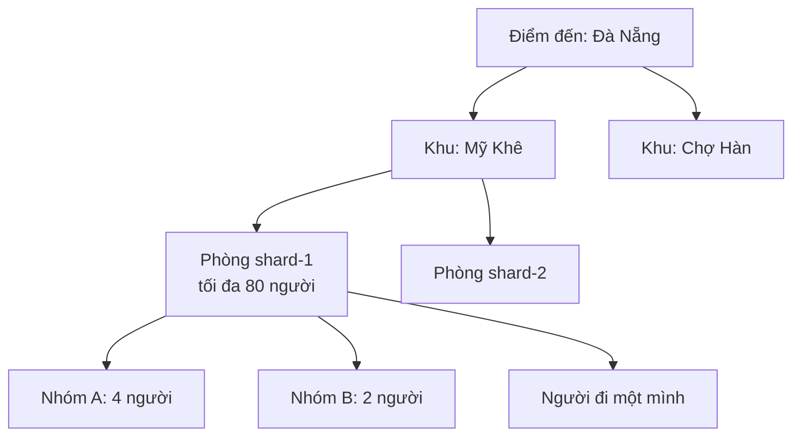
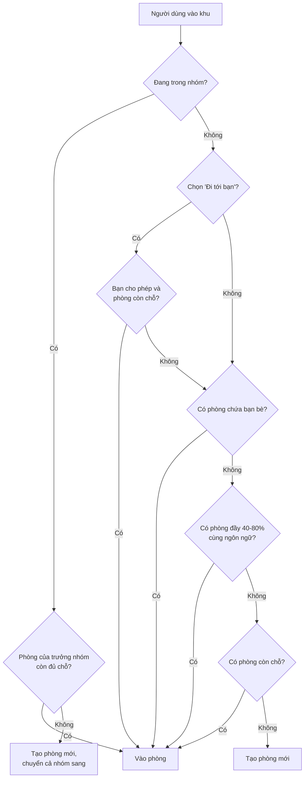
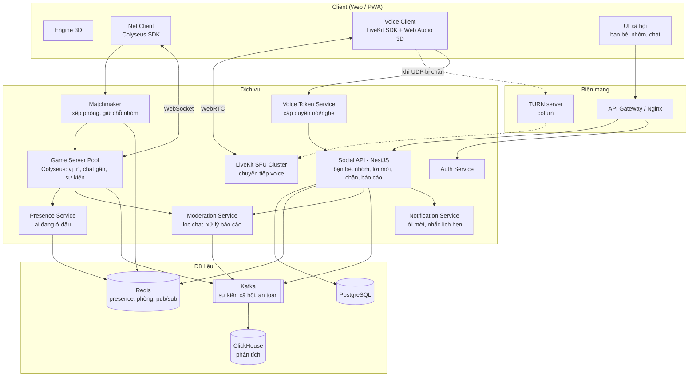
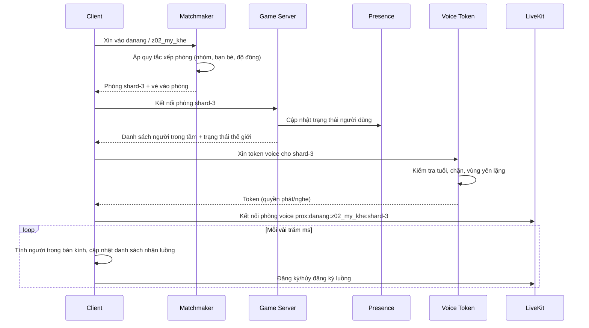
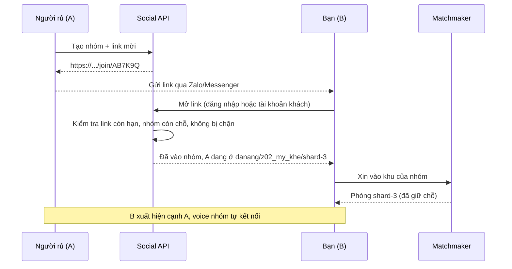
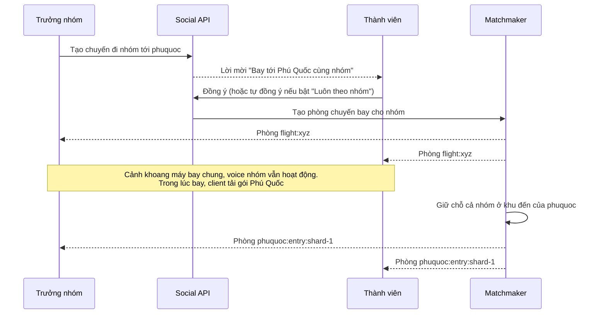
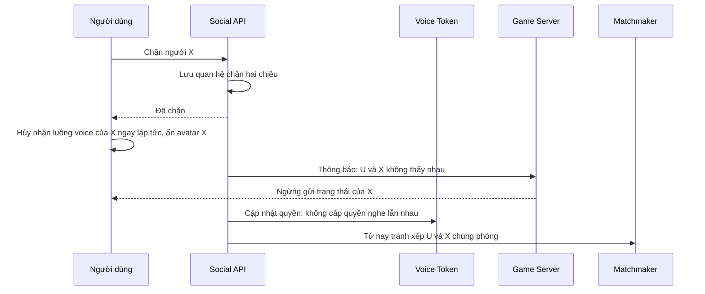

# THIẾT KẾ CHƠI CÙNG NHAU: GẶP GỠ, NHÓM BẠN VÀ VOICE CHAT

> Thuộc nền tảng **Việt Nam Online** (tên tạm). Tài liệu này áp dụng cho **mọi điểm đến**.
> Liên quan: `00-Ke-hoach-nen-tang.md` (kiến trúc chung), `01-DaNang-Diem-den-thi-diem.md` (điểm đến thí điểm).

| Thông tin | Chi tiết |
|---|---|
| Phạm vi | Gặp người khác tại cùng địa điểm, đi du lịch theo nhóm bạn, trò chuyện bằng mic và chat, an toàn cộng đồng |
| Phiên bản tài liệu | v1.0 |
| Trạng thái | Thiết kế, chưa triển khai |
| Người phụ trách | AnhNX |

---

## Mục lục

1. [Mục tiêu và tình huống sử dụng](#1-mục-tiêu-và-tình-huống-sử-dụng)
2. [Khái niệm cốt lõi](#2-khái-niệm-cốt-lõi)
3. [Gặp nhau tại cùng địa điểm](#3-gặp-nhau-tại-cùng-địa-điểm)
4. [Nhóm bạn (Party): đi du lịch cùng nhau](#4-nhóm-bạn-party-đi-du-lịch-cùng-nhau)
5. [Bạn bè và trạng thái online](#5-bạn-bè-và-trạng-thái-online)
6. [Voice chat qua mic](#6-voice-chat-qua-mic)
7. [Chat chữ và biểu cảm](#7-chat-chữ-và-biểu-cảm)
8. [Trải nghiệm chung: những khoảnh khắc làm cùng nhau](#8-trải-nghiệm-chung-những-khoảnh-khắc-làm-cùng-nhau)
9. [An toàn và kiểm duyệt](#9-an-toàn-và-kiểm-duyệt)
10. [Quyền riêng tư và pháp lý](#10-quyền-riêng-tư-và-pháp-lý)
11. [Kiến trúc kỹ thuật](#11-kiến-trúc-kỹ-thuật)
12. [Đồng bộ trạng thái thế giới](#12-đồng-bộ-trạng-thái-thế-giới)
13. [Luồng xử lý chính](#13-luồng-xử-lý-chính)
14. [Mô hình dữ liệu](#14-mô-hình-dữ-liệu)
15. [Điều khiển và giao diện](#15-điều-khiển-và-giao-diện)
16. [Cấu hình theo điểm đến](#16-cấu-hình-theo-điểm-đến)
17. [Năng lực, mở rộng và chi phí](#17-năng-lực-mở-rộng-và-chi-phí)
18. [Lộ trình triển khai](#18-lộ-trình-triển-khai)
19. [KPI](#19-kpi)
20. [Rủi ro](#20-rủi-ro)

---

## 1. Mục tiêu và tình huống sử dụng

### 1.1. Mục tiêu

> **Du lịch là đi cùng nhau.** Người dùng vào cùng một địa điểm thì gặp nhau ở đó; bạn bè có thể rủ nhau đi chung cả chuyến, nói chuyện bằng giọng nói như đang đi thật.

| Mục tiêu | Mô tả |
|---|---|
| Gặp gỡ tự nhiên | Ai vào cùng địa điểm sẽ thấy nhau, chào nhau, nói chuyện nếu muốn |
| Đi cùng bạn bè | Rủ bạn bằng link, cả nhóm luôn ở cùng phòng, cùng di chuyển, cùng nói chuyện |
| Nói chuyện như thật | Người đứng gần nghe rõ, đi xa nghe nhỏ dần, có hướng trái phải |
| An toàn | Người dùng luôn kiểm soát được ai nghe mình, mình nghe ai; xử lý nhanh hành vi xấu |

### 1.2. Tình huống sử dụng

| # | Tình huống | Kỳ vọng của người dùng |
|---|---|---|
| U1 | Đi một mình, vào biển Mỹ Khê | Thấy nhiều người khác đang dạo biển, có thể chào hỏi người lạ |
| U2 | Rủ 3 người bạn đi Đà Nẵng tối thứ Bảy | Gửi link, bạn bấm vào là xuất hiện cạnh mình, cả nhóm nói chuyện qua mic suốt chuyến |
| U3 | Nhóm bạn ở 3 thành phố khác nhau | Hẹn giờ, cùng vào, cùng xem Cầu Rồng phun lửa, cùng chụp ảnh nhóm |
| U4 | Đang đi với nhóm, gặp nhóm khác ở chợ | Nói chuyện với nhóm kia bằng giọng theo khoảng cách, vẫn nghe nhóm mình rõ |
| U5 | Cả nhóm đổi điểm đến (Đà Nẵng → Phú Quốc) | Lên cùng chuyến bay, hạ cánh cùng phòng |
| U6 | Hướng dẫn viên dẫn đoàn 30 người | Cả đoàn nghe hướng dẫn viên rõ, khách trong đoàn nói chuyện với người đứng gần |
| U7 | Bị người lạ quấy rối bằng giọng nói | Một chạm là tắt tiếng hoặc chặn, người đó biến mất khỏi trải nghiệm của mình |
| U8 | Người dùng chưa đủ 18 tuổi | Chơi cùng bạn bè đã kết bạn, không bị người lạ nói chuyện bằng giọng nói |

---

## 2. Khái niệm cốt lõi

| Khái niệm | Định nghĩa |
|---|---|
| **Điểm đến** (Destination) | Đà Nẵng, Phú Quốc… (một gói điểm đến) |
| **Khu** (Zone) | Một khu trong điểm đến: Mỹ Khê, Chợ Hàn… |
| **Phòng** (Shard) | Một bản của khu, chứa tối đa N người cùng thấy nhau. Một khu đông người sẽ có nhiều phòng song song. Khóa phòng: `danang:z02_my_khe:shard-3` |
| **Nhóm** (Party) | Nhóm bạn đi cùng nhau (tối đa 8 người). Nhóm luôn được xếp vào cùng phòng. |
| **Bạn bè** (Friend) | Quan hệ kết bạn lâu dài giữa hai tài khoản |
| **Trạng thái** (Presence) | Ai đang online, đang ở điểm đến, khu, phòng nào |
| **Voice gần** (Proximity voice) | Nghe người đứng gần trong bán kính, âm lượng theo khoảng cách, có hướng |
| **Voice nhóm** (Party voice) | Nghe thành viên nhóm ở bất kỳ đâu, không phụ thuộc khoảng cách |
| **Voice dẫn đoàn** (Broadcast voice) | Hướng dẫn viên nói, cả đoàn nghe |
| **Vùng yên lặng** (Quiet zone) | Khu hạn chế voice (khu tâm linh, phòng thư giãn) |



---

## 3. Gặp nhau tại cùng địa điểm

### 3.1. Vì sao cần chia phòng

Một khu có thể có hàng nghìn người cùng lúc. Nếu tất cả ở chung một không gian: máy yếu không vẽ nổi, mạng không gửi nổi vị trí, voice thành tiếng ồn hỗn loạn. Vì vậy mỗi khu chia thành **phòng** có sức chứa giới hạn.

Mục tiêu thiết kế: **người dùng không cảm thấy có "phòng"**. Họ chỉ thấy khu luôn có người, bạn bè luôn ở cạnh mình.

### 3.2. Sức chứa phòng

| Loại khu | Sức chứa gợi ý | Lý do |
|---|---|---|
| Khu ngoài trời rộng (biển, quảng trường) | 60–80 | Không gian rộng, người phân tán |
| Khu trong nhà, hẹp (chợ, hang động) | 30–40 | Mật độ cao dễ chen chúc, nặng render |
| Khu tâm linh | 20–30 | Giữ không khí yên tĩnh |
| Phương tiện (cabin cáp treo, taxi) | 4–8 | Theo sức chứa thật của phương tiện |
| Sự kiện lớn (Cầu Rồng phun lửa) | 80–150 | Có lớp đám đông giản lược (mục 3.6) |

Sức chứa do gói điểm đến khai báo trong cấu hình zone (`maxPlayersPerRoom`) và có thể điều chỉnh từ phía máy chủ.

### 3.3. Quy tắc xếp phòng (Matchmaking)

Khi người dùng vào một khu, hệ thống chọn phòng theo thứ tự ưu tiên:

| Ưu tiên | Quy tắc |
|---|---|
| 1 | **Đang trong nhóm:** vào phòng của trưởng nhóm. Giữ chỗ cho cả nhóm. |
| 2 | **Chọn "Đi tới bạn":** vào phòng của người bạn đó (nếu bạn cho phép). |
| 3 | **Có bạn bè trong khu:** ưu tiên phòng có nhiều bạn bè nhất. |
| 4 | **Phòng "đông vừa đủ":** ưu tiên phòng đang đầy 40–80%, cùng ngôn ngữ ưu tiên. Tránh xếp vào phòng vắng tanh. |
| 5 | **Không có phòng phù hợp:** tạo phòng mới. |



### 3.4. Giữ chỗ cho nhóm

- Khi nhóm di chuyển sang khu mới, Matchmaker **giữ chỗ cho cả nhóm** trong 60 giây.
- Thành viên chậm (đang tải) vẫn được vào đúng phòng của nhóm.
- Nếu phòng của trưởng nhóm không còn đủ chỗ, cả nhóm được đưa sang phòng khác **cùng lúc**, không tách nhóm.

### 3.5. Gộp và chuyển phòng

- Khi hai phòng cùng khu đều vắng (dưới 20% trong 5 phút), hệ thống **gợi ý gộp** vào thời điểm tự nhiên: lúc người dùng chuyển khu, lên phương tiện, hoặc qua màn chuyển cảnh. Không giật người dùng sang phòng khác giữa lúc đang nói chuyện.
- Người dùng có thể mở **danh sách phòng** của khu (số người, có bạn bè không) và tự chuyển.
- Chuyển phòng giữ nguyên vị trí trong khu, chỉ thay đổi những người xung quanh.

### 3.6. Lớp đám đông liên phòng (giai đoạn sau)

Ở sự kiện lớn, người ở các phòng khác có thể hiển thị dạng **đám đông giản lược**: vị trí cập nhật thưa (1–2 lần/giây), avatar đơn giản, không voice, không tương tác. Người dùng thấy "cả nghìn người đang cùng xem Cầu Rồng" mà máy chủ và máy người dùng vẫn chịu được.

---

## 4. Nhóm bạn (Party): đi du lịch cùng nhau

### 4.1. Thông số nhóm

| Thuộc tính | Giá trị |
|---|---|
| Số thành viên tối đa | 8 (vừa một cabin cáp treo, dễ trò chuyện) |
| Vai trò | Trưởng nhóm (1), thành viên |
| Thời gian sống | Tồn tại khi còn ít nhất 1 thành viên online; tự giải tán sau 30 phút không ai online |
| Nhóm đoàn (dẫn tour) | Loại riêng, tối đa 30–50 người, xem mục 6.6 |

### 4.2. Cách rủ bạn vào nhóm

| Cách | Mô tả | Dùng khi |
|---|---|---|
| **Link mời** | `https://.../join/AB7K9Q`, gửi qua Zalo, Messenger | Rủ bạn chưa có tài khoản hoặc chưa kết bạn |
| **Mã nhóm** | 6 ký tự, nhập trong ứng dụng | Đọc cho nhau qua điện thoại |
| **Mã QR** | Hiển thị trên màn hình | Bạn ngồi cạnh, quét bằng điện thoại |
| **Mời từ danh sách bạn bè** | Bấm "Mời vào nhóm" | Bạn đã kết bạn đang online |
| **Mời người vừa gặp** | Bấm vào avatar người đứng gần, chọn "Mời vào nhóm" | Gặp người lạ hợp chuyện |

Link mời có thời hạn (mặc định 24 giờ), trưởng nhóm có thể thu hồi. Người bấm link chưa có tài khoản được vào bằng **tài khoản khách** (xem 9.3 về giới hạn của tài khoản khách).

### 4.3. Đi cùng nhau

| Hành động | Cách hoạt động |
|---|---|
| Vào điểm đến | Thành viên mới xuất hiện cạnh trưởng nhóm |
| Chuyển khu (đi bộ, taxi) | Trưởng nhóm chọn "Đi cùng nhóm" → thành viên nhận lời mời "Đi cùng" (tự đồng ý nếu bật "Luôn theo nhóm"). Cả nhóm vào cùng phương tiện, cùng cảnh chuyển, đến cùng phòng. |
| Đi riêng | Thành viên có thể tách ra khám phá khu khác. Vẫn trong nhóm, vẫn nghe voice nhóm, thấy vị trí bạn trên bản đồ. |
| Quay về với nhóm | Nút "Đến chỗ nhóm" hoặc "Đến chỗ [tên bạn]" |
| Cáp treo, thuyền | Cả nhóm vào chung một cabin hoặc thuyền (giữ chỗ). Nếu nhóm 8 người mà cabin chứa 6, hệ thống chia 2 cabin liền nhau, voice nhóm không bị ảnh hưởng. |
| Đổi điểm đến | Trưởng nhóm đặt "chuyến bay" → thành viên nhận lời mời → cả nhóm cùng cảnh khoang máy bay (chung một phòng) → hạ cánh cùng phòng ở điểm đến mới |

### 4.4. Hẹn gặp

- **Đặt lịch đi chơi:** trưởng nhóm tạo lịch (ví dụ: "Thứ Bảy 20:45, gặp ở Cầu Rồng xem phun lửa"), gửi link. Hệ thống nhắc trước 15 phút.
- **Ghim điểm hẹn:** đặt ghim trên bản đồ khu, thành viên thấy mũi tên chỉ đường tới ghim.
- **Kiểm tra sẵn sàng:** trước khi cả nhóm di chuyển, trưởng nhóm có thể bấm "Sẵn sàng chưa?", thành viên bấm xác nhận.

### 4.5. Hiển thị nhóm trong thế giới

- Tên thành viên nhóm luôn hiện (có màu nhóm), kể cả khi ở xa.
- Mũi tên ở rìa màn hình chỉ hướng thành viên đang ngoài tầm nhìn.
- Bản đồ khu hiển thị vị trí từng thành viên.
- Biểu tượng loa sáng lên khi thành viên đang nói.

---

## 5. Bạn bè và trạng thái online

### 5.1. Kết bạn

- Gửi lời mời kết bạn từ: người cùng nhóm, người đứng gần, tên người dùng, link hồ sơ.
- Giới hạn số lời mời gửi mỗi ngày để chống spam.
- Có thể tắt hoàn toàn việc nhận lời mời từ người lạ.

### 5.2. Trạng thái (Presence)

| Trạng thái | Hiển thị cho bạn bè |
|---|---|
| Online, đang ở khu | "Đang ở Biển Mỹ Khê, Đà Nẵng" + nút "Đi tới" |
| Online, đang di chuyển | "Đang trên cáp treo Bà Nà" |
| Online, đang trong nhóm đầy | "Đang đi cùng nhóm (8/8)" |
| Không làm phiền | Hiện online, không nhận lời mời |
| Ẩn | Hiện như offline |
| Offline | "Hoạt động 2 giờ trước" (có thể tắt) |

### 5.3. Thiết lập quyền riêng tư

| Thiết lập | Lựa chọn | Mặc định |
|---|---|---|
| Ai thấy tôi đang ở đâu | Bạn bè / Không ai | Bạn bè |
| Ai được "Đi tới" chỗ tôi | Bạn bè / Không ai | Bạn bè |
| Ai được mời tôi vào nhóm | Mọi người / Bạn bè / Không ai | Bạn bè |
| Ai được gửi kết bạn | Mọi người / Bạn của bạn / Không ai | Mọi người |

---

## 6. Voice chat qua mic

### 6.1. Các kênh voice

| Kênh | Ai nghe | Âm thanh | Khi nào |
|---|---|---|---|
| **Voice gần** | Người đứng trong bán kính (mặc định 20 m) | Không gian 3D: gần nghe to, xa nghe nhỏ, có hướng trái phải | Luôn có ở khu bình thường |
| **Voice nhóm** | Mọi thành viên nhóm, ở bất kỳ đâu | Âm thanh thường (không 3D), hoặc 3D nếu đang đứng gần nhau | Khi đang trong nhóm |
| **Voice dẫn đoàn** | Toàn bộ đoàn | Rõ, ưu tiên, giảm âm các kênh khác khi đang phát | Tour có hướng dẫn viên |
| **Voice phương tiện** | Người cùng cabin, cùng xe | Âm thanh thường, có hiệu ứng không gian nhỏ (trong cabin) | Khi ngồi chung phương tiện |

### 6.2. Nói theo nhóm hay nói ra xung quanh

Người dùng trong nhóm chọn **mic đang phát tới đâu**:

| Chế độ mic | Ai nghe mình | Biểu tượng |
|---|---|---|
| **Nhóm** (mặc định khi trong nhóm) | Chỉ thành viên nhóm | Biểu tượng nhóm |
| **Xung quanh** | Thành viên nhóm + người đứng gần | Biểu tượng sóng âm |
| **Tắt** | Không ai | Mic gạch chéo |

Khi không trong nhóm, mặc định là **Xung quanh**. Chuyển nhanh bằng phím tắt (mục 15).

Về phía nghe, người dùng chỉnh riêng âm lượng: voice nhóm, voice người lạ, voice dẫn đoàn, âm thanh môi trường.

### 6.3. Cách bật mic

| Cách | Mô tả | Mặc định cho |
|---|---|---|
| **Giữ để nói** (Push-to-talk) | Giữ phím hoặc nút mic, thả ra là tắt | Kênh **Xung quanh** với người lạ |
| **Mic mở** (Voice activity) | Tự phát khi phát hiện giọng nói | Kênh **Nhóm** |

Lý do: nói chuyện với bạn bè thì mic mở tự nhiên hơn; nói ra xung quanh với người lạ thì giữ để nói giúp tránh lọt âm thanh riêng tư (tiếng trong nhà, tiếng TV) ra cho người lạ nghe.

### 6.4. Âm thanh không gian 3D

| Thông số | Giá trị gợi ý |
|---|---|
| Bán kính nghe rõ hoàn toàn | 3 m |
| Bán kính nghe tối đa | 20 m (khu ngoài trời), 12 m (trong nhà) |
| Đường giảm âm | Giảm dần theo khoảng cách (mô hình inverse), về 0 ở bán kính tối đa |
| Định hướng | HRTF (nghe tai nghe sẽ rõ trái, phải, trước, sau) |
| Hiệu ứng không gian | Dùng chung reverb của khu: trong hang có vang, trong cabin âm thanh gần |
| Che khuất | Giai đoạn sau: người sau tường, trong phòng khác nghe bị nghẹt |

Âm thanh 3D được xử lý **trên máy người nghe** bằng Web Audio API, dựa trên vị trí avatar lấy từ máy chủ game. Máy chủ voice chỉ chuyển tiếp âm thanh, không cần biết vị trí.

### 6.5. Chọn lọc luồng âm thanh

Để tiết kiệm băng thông và giữ âm thanh dễ nghe, máy người dùng **chỉ nhận luồng voice cần thiết**:

1. Luôn nhận: thành viên nhóm, hướng dẫn viên (nếu đang trong đoàn).
2. Voice gần: nhận tối đa **12 người** trong bán kính, ưu tiên người gần nhất và người vừa nói gần đây.
3. Người bị mình tắt tiếng hoặc chặn: **không bao giờ nhận**.

Danh sách nhận luồng được cập nhật vài lần mỗi giây theo vị trí.

### 6.6. Voice dẫn đoàn

- Hướng dẫn viên (hoặc streamer) tạo **đoàn** loại đặc biệt, tối đa 30–50 người.
- Hướng dẫn viên có kênh phát cho toàn đoàn; khi phát, các kênh khác của khách tự giảm âm.
- Khách trong đoàn vẫn có voice gần để nói chuyện với người bên cạnh.
- Hướng dẫn viên có quyền: tắt tiếng một khách trong đoàn, mời khách nói (giơ tay), dẫn đoàn chuyển khu.

### 6.7. Chất lượng âm thanh

| Hạng mục | Giải pháp |
|---|---|
| Codec | Opus (mặc định của WebRTC), bật DTX (không gửi dữ liệu khi im lặng) |
| Khử tiếng vọng, khử ồn | Bật `echoCancellation`, `noiseSuppression`, `autoGainControl` của trình duyệt; giai đoạn sau xem xét khử ồn bằng mô hình (RNNoise hoặc tương đương) |
| Mạng yếu | Tự giảm bitrate; nếu mất kết nối voice, giữ nguyên trò chơi và tự kết nối lại |
| Mạng chặn UDP | Dùng máy chủ TURN (TCP/TLS 443) để vượt tường lửa công ty, trường học |
| Chỉ báo | Vòng sáng quanh avatar khi đang nói; thanh mức âm khi tự kiểm tra mic |

### 6.8. Vấn đề cần kiểm chứng sớm (rủi ro kỹ thuật)

Các điểm dưới đây cần thử nghiệm thực tế trên thiết bị thật ngay trong giai đoạn prototype:

- Đưa luồng âm thanh WebRTC từ xa vào Web Audio để làm âm thanh 3D: hành vi khác nhau giữa các trình duyệt, cần thử trên Chrome, Safari, Firefox, Safari iOS, Chrome Android.
- iOS Safari: cấp quyền mic, khởi động AudioContext sau thao tác người dùng, xử lý khi ứng dụng chạy nền hoặc khóa màn hình.
- Dùng mic cùng loa ngoài trên điện thoại: hiệu quả khử tiếng vọng.
- Hiệu năng: render 3D, giải mã nhiều luồng âm thanh và xử lý âm thanh 3D cùng lúc trên điện thoại tầm trung.

---

## 7. Chat chữ và biểu cảm

### 7.1. Kênh chat

| Kênh | Phạm vi |
|---|---|
| Gần | Người trong bán kính 20 m; tin nhắn hiện thành bong bóng trên đầu avatar |
| Nhóm | Thành viên nhóm |
| Riêng | Giữa hai người là bạn bè |
| Đoàn | Toàn đoàn (chỉ hướng dẫn viên được ghim tin) |

Chat chữ là phương án cho người không muốn hoặc không thể dùng mic, và luôn có ở mọi khu (kể cả khu hạn chế voice, với chế độ phù hợp).

### 7.2. Biểu cảm (emote)

Vẫy tay, chào, vỗ tay, cười, chỉ tay, ngồi, chụp ảnh tự sướng, nhảy (chỉ ở khu phù hợp). Biểu cảm là cách giao tiếp nhẹ nhàng với người lạ mà không cần mic.

**Bánh xe biểu cảm nhanh** cho người dùng điện thoại.

---

## 8. Trải nghiệm chung: những khoảnh khắc làm cùng nhau

| Khoảnh khắc | Mô tả |
|---|---|
| **Ảnh nhóm** | Một người mở chế độ chụp ảnh nhóm, các thành viên nhận lời mời "Tạo dáng", hệ thống đếm ngược, cả nhóm nhận ảnh |
| **Cùng xem sự kiện** | Nhóm được đề xuất vị trí đứng xem cạnh nhau; voice nhóm tự giảm âm môi trường khi pháo hoa nổ để vẫn nghe nhau |
| **Ngồi chung** | Ghế đá, bãi cát, quán cà phê có nhiều chỗ ngồi liền nhau; ngồi cạnh nhau tự chuyển sang camera nhóm |
| **Cùng ăn** | Bàn ăn ở chợ: gọi món chung, mỗi người nhận thẻ món ăn |
| **Đi chung phương tiện** | Cabin cáp treo, thuyền, xe máy chở hai người (một người lái) |
| **Nhiệm vụ nhóm** | Nhiệm vụ cần nhiều người: bóng chuyền bãi biển, xây lâu đài cát cùng nhau, "đủ 4 người cùng ngắm bình minh" |
| **Bưu thiếp chuyến đi nhóm** | Cuối chuyến, cả nhóm nhận bưu thiếp chung có tên mọi người, lộ trình, ảnh nhóm |
| **Hộ chiếu ghi chú "đi cùng"** | Dấu hộ chiếu ghi lại đi cùng ai, để sau này mở xem lại kỷ niệm |

---

## 9. An toàn và kiểm duyệt

Voice với người lạ là tính năng **rủi ro cao nhất** của nền tảng. Nguyên tắc: **người dùng luôn kiểm soát được trải nghiệm của mình, và mặc định an toàn.**

### 9.1. Công cụ cho người dùng

| Công cụ | Tác dụng | Thao tác |
|---|---|---|
| **Tắt tiếng** (Mute) | Không nghe giọng, không thấy chat của người đó | 1 chạm vào avatar hoặc tên |
| **Chặn** (Block) | Như tắt tiếng + người đó **biến mất** khỏi thế giới của mình và mình biến mất khỏi thế giới của họ; không gửi được lời mời, không vào chung nhóm; Matchmaker tránh xếp chung phòng | 1 chạm + xác nhận |
| **Báo cáo** (Report) | Gửi báo cáo cho đội kiểm duyệt; tự động tắt tiếng người bị báo cáo với người báo cáo | Chọn lý do, có thể ghi chú |
| **Vùng an toàn cá nhân** | Avatar người khác không thể đứng sát hơn 1 m (bật mặc định với người lạ) | Bật/tắt trong cài đặt |
| **Chỉ nghe bạn bè** | Tắt toàn bộ voice người lạ, chỉ nghe nhóm và bạn bè | Công tắc nhanh |
| **Thoát nhanh** | Dịch chuyển về điểm an toàn của khu hoặc sang phòng khác ngay lập tức | Nút trên giao diện |

### 9.2. Mặc định theo độ tuổi

| Nhóm | Voice với nhóm và bạn bè | Voice với người lạ | Chat với người lạ |
|---|---|---|---|
| 18 tuổi trở lên | Bật | Bật (giữ để nói) | Bật, có lọc từ |
| Dưới 18 tuổi | Bật (chỉ bạn bè đã kết bạn) | **Tắt, không mở được** | Chỉ câu chọn sẵn và biểu cảm |
| Chưa khai báo tuổi, tài khoản khách | Bật (chỉ nhóm đã tham gia qua link) | Tắt | Chỉ câu chọn sẵn và biểu cảm |

> Phương án xác minh tuổi cụ thể cần được xác định cùng tư vấn pháp lý, theo quy định về bảo vệ trẻ em trên môi trường mạng.

### 9.3. Giới hạn tài khoản mới và tài khoản khách

- Tài khoản khách (vào bằng link mời): chỉ voice và chat trong nhóm đã mời mình.
- Tài khoản mới dưới 24 giờ: giới hạn số lời mời kết bạn, số tin nhắn gần mỗi phút.
- Mở dần quyền khi tài khoản có lịch sử tốt.

### 9.4. Kiểm duyệt phía hệ thống

| Lớp | Biện pháp |
|---|---|
| Chat chữ | Lọc từ ngữ tự động (tiếng Việt có dấu, không dấu, viết tắt, lách chữ); giới hạn tốc độ gửi; chặn gửi link, số điện thoại với người lạ |
| Tên hiển thị, lời nhắn ổ khóa, sổ lưu bút | Lọc tự động trước khi hiển thị, báo cáo được |
| Voice | Không ghi âm mặc định. Xử lý dựa trên báo cáo và tín hiệu hành vi (bị nhiều người tắt tiếng, chặn, báo cáo trong thời gian ngắn) |
| Hành vi | Tự động hạn chế voice gần của tài khoản bị nhiều báo cáo, chờ kiểm duyệt viên xem xét |
| Kiểm duyệt viên | Công cụ quản trị: xem báo cáo, lịch sử chat liên quan, cảnh cáo, khóa voice, khóa tài khoản tạm thời hoặc vĩnh viễn |
| Kiểm duyệt viên trong game | Giai đoạn sau: kiểm duyệt viên có thể vào phòng ở chế độ ẩn để xử lý trực tiếp |

### 9.5. Bằng chứng khi báo cáo voice

Vì không ghi âm mặc định, báo cáo voice dựa trên: thời gian, phòng, người liên quan, lịch sử báo cáo, tín hiệu hành vi. Phương án **bộ đệm ghi âm ngắn chỉ lưu khi người dùng bấm báo cáo** có thể cân nhắc ở giai đoạn sau, nhưng **chỉ triển khai sau khi có tư vấn pháp lý** và thông báo rõ cho người dùng.

### 9.6. Quy tắc cộng đồng

Hiển thị ngắn gọn khi người dùng lần đầu bật voice với người lạ, phải bấm đồng ý. Nội dung chính: tôn trọng người khác, không quấy rối, không phân biệt đối xử, không chia sẻ thông tin cá nhân, giữ yên lặng ở khu tâm linh.

---

## 10. Quyền riêng tư và pháp lý

| Vấn đề | Cách xử lý |
|---|---|
| Quyền dùng mic | Chỉ xin quyền khi người dùng bấm bật mic lần đầu, giải thích ngắn lý do. Từ chối mic vẫn chơi được bình thường (chat chữ, biểu cảm). |
| Dữ liệu giọng nói | Không lưu trữ mặc định. Máy chủ voice chỉ chuyển tiếp luồng. Nếu sau này có ghi âm cho báo cáo hay ghi lại tour, phải có đồng ý rõ ràng và chính sách lưu trữ. |
| Vị trí trong game | Là dữ liệu trong trò chơi, không phải vị trí thật; vẫn tôn trọng thiết lập ẩn trạng thái |
| Dữ liệu cá nhân | Tuân thủ quy định bảo vệ dữ liệu cá nhân của Việt Nam (Nghị định 13/2023, Luật Bảo vệ dữ liệu cá nhân); chỉ thu thập dữ liệu cần thiết |
| Trẻ vị thành niên | Mặc định an toàn theo mục 9.2; quy trình xác minh tuổi theo tư vấn pháp lý |
| Dịch vụ mạng xã hội, trò chơi | Tính năng kết bạn, chat, voice có thể khiến sản phẩm thuộc diện cần giấy phép, đăng ký theo quy định về dịch vụ trên mạng. Cần xác định với luật sư trước khi mở công khai. |
| Lưu nhật ký chat | Thời hạn lưu tối thiểu cần thiết cho kiểm duyệt và theo yêu cầu pháp luật; công khai trong chính sách quyền riêng tư |

> Phần pháp lý mang tính định hướng, cần tư vấn luật sư trước khi phát hành công khai.

---

## 11. Kiến trúc kỹ thuật

### 11.1. Sơ đồ tổng thể



### 11.2. Phân vai các thành phần

| Thành phần | Công nghệ | Trách nhiệm |
|---|---|---|
| **Game Server** | Colyseus (Node.js) | Một room Colyseus = một phòng (shard). Đồng bộ vị trí, hoạt cảnh, biểu cảm, chat gần, ghế ngồi, chỗ trên phương tiện. Là nguồn sự thật cho vị trí avatar. |
| **Matchmaker** | Node.js/NestJS + Redis | Chọn phòng theo quy tắc mục 3.3, giữ chỗ cho nhóm, tạo phòng mới, gợi ý gộp phòng |
| **Presence** | Redis (hash + TTL, pub/sub) | Lưu `user → destination/zone/shard/party`, phát thay đổi cho bạn bè |
| **Social API** | NestJS + PostgreSQL | Bạn bè, nhóm, lời mời, link mời, chặn, báo cáo, thiết lập quyền riêng tư |
| **Voice SFU** | LiveKit (mã nguồn mở, tự host) | Chuyển tiếp luồng âm thanh; hỗ trợ đăng ký nhận luồng có chọn lọc |
| **Voice Token Service** | NestJS | Cấp token LiveKit kèm quyền: được phát vào kênh nào, được nghe kênh nào. Áp quy tắc tuổi, chặn, vùng yên lặng. |
| **TURN** | coturn | Giúp kết nối voice khi mạng chặn UDP |
| **Moderation** | NestJS + bộ lọc từ ngữ | Lọc chat, nhận báo cáo, hạn chế tự động, công cụ cho kiểm duyệt viên |
| **Notification** | NestJS + Web Push | Lời mời nhóm, lời mời kết bạn, nhắc lịch hẹn, sự kiện bắt đầu |

### 11.3. Ánh xạ phòng game và phòng voice

| Phòng LiveKit | Tương ứng | Ai tham gia |
|---|---|---|
| `prox:{destination}:{zone}:{shard}` | Một phòng game | Mọi người trong phòng game (tham gia với quyền phát/nghe theo thiết lập) |
| `party:{partyId}` | Một nhóm | Thành viên nhóm, ở bất kỳ phòng game nào |
| `tour:{tourSessionId}` | Một đoàn | Hướng dẫn viên (phát), khách (nghe, phát khi được mời) |
| `vehicle:{vehicleInstanceId}` | Một cabin, một xe | Người đang ngồi trên phương tiện |

Một người dùng có thể kết nối đồng thời 2–3 phòng LiveKit (gần + nhóm, hoặc gần + đoàn). Client trộn âm thanh từ các phòng và áp dụng âm thanh 3D cho kênh gần.

**Phương án thay thế:** dùng một phòng LiveKit cho cả phòng game và phân kênh nhóm bằng quyền đăng ký luồng. Ít kết nối hơn nhưng logic quyền phức tạp hơn. Chọn phương án cuối cùng sau khi prototype đo được tải thực tế.

### 11.4. Lựa chọn giải pháp voice

| Tiêu chí | Tự host LiveKit | Dịch vụ voice có phí (Agora, LiveKit Cloud, Vivox…) |
|---|---|---|
| Chi phí khi ít người | Có chi phí máy chủ cố định | Thấp, trả theo phút |
| Chi phí khi đông người | Thấp hơn | Tăng theo số phút sử dụng |
| Kiểm soát dữ liệu | Toàn quyền, dữ liệu ở máy chủ mình chọn | Phụ thuộc nhà cung cấp |
| Công sức vận hành | Cao (cụm SFU, TURN, giám sát) | Thấp |
| Âm thanh 3D | Tự làm ở client | Một số dịch vụ có sẵn |

**Đề xuất:** dùng LiveKit vì có cả bản tự host lẫn bản cloud cùng API. Thí điểm có thể chạy bản cloud cho nhanh, khi lượng dùng tăng thì chuyển sang tự host mà không phải viết lại client. Cần so sánh giá cụ thể tại thời điểm triển khai.

---

## 12. Đồng bộ trạng thái thế giới

### 12.1. Dữ liệu đồng bộ

| Dữ liệu | Tần suất | Ghi chú |
|---|---|---|
| Vị trí, hướng nhìn | 10–15 lần/giây | Client gửi đầu vào, server kiểm tra hợp lệ (tốc độ tối đa, không xuyên tường), phát cho người trong tầm |
| Trạng thái hoạt cảnh | Khi thay đổi | Đứng, đi, chạy, ngồi, bơi |
| Biểu cảm | Khi xảy ra | |
| Đang nói | Khi thay đổi | Lấy từ LiveKit, hiển thị vòng sáng |
| Chỗ ngồi, chỗ trên phương tiện | Khi thay đổi | Server cấp phát, chống hai người cùng một ghế |
| Trang phục avatar | Khi vào phòng và khi đổi | |
| Chat gần | Khi gửi | Đi qua bộ lọc trước khi phát |

### 12.2. Tối ưu mạng

- **Chia lưới không gian (AOI):** server chỉ gửi cập nhật của người trong các ô lưới lân cận (ví dụ ô 25 m).
- **Tần suất theo khoảng cách:** người gần cập nhật 15 lần/giây, người xa 3–5 lần/giây.
- **Nén:** Colyseus chỉ gửi phần thay đổi; lượng tử hóa vị trí (độ chính xác cm) và góc.
- **Nội suy phía client:** hiển thị người khác trễ khoảng 100 ms để chuyển động mượt.
- **Dự đoán phía client:** nhân vật của mình di chuyển ngay khi bấm phím, server hiệu chỉnh khi lệch nhiều.

### 12.3. Ước tính băng thông mỗi người dùng

| Luồng | Ước tính |
|---|---|
| Đồng bộ vị trí (80 người, có AOI) | Khoảng 10–30 kbps nhận |
| Voice phát (1 luồng Opus) | Khoảng 24–32 kbps khi đang nói, gần 0 khi im (DTX) |
| Voice nhận (tối đa 12 luồng gần + nhóm) | Khoảng 50–300 kbps tùy số người đang nói |
| Asset 3D | Tải theo chunk, không tính vào luồng thời gian thực |

Mạng 4G thông thường đáp ứng được; cần thử nghiệm thực tế với mạng yếu.

---

## 13. Luồng xử lý chính

### 13.1. Vào một khu và gặp người khác



### 13.2. Rủ bạn bằng link và đi cùng



### 13.3. Cả nhóm đổi điểm đến



### 13.4. Chặn một người



---

## 14. Mô hình dữ liệu

```sql
-- Bạn bè
friend_requests   (id, from_user_id, to_user_id, status: pending|accepted|declined|cancelled,
                   created_at, responded_at)
friendships       (user_id, friend_id, created_at)             -- lưu hai chiều

-- Nhóm
parties           (id, type: friends|tour, leader_id, max_size, current_destination,
                   current_zone, current_shard, created_at, disbanded_at)
party_members     (party_id, user_id, role: leader|member|guide|guest, joined_at, left_at,
                   always_follow BOOLEAN)
party_invites     (id, party_id, code CHAR(6), created_by, expires_at, max_uses, uses, revoked_at)
party_schedules   (id, party_id, title, destination, zone, meet_at, pin_position JSONB)

-- An toàn
blocks            (blocker_id, blocked_id, created_at)
mutes             (user_id, muted_id, created_at)              -- có thể lưu phía client
reports           (id, reporter_id, reported_id, category, note, context JSONB,
                   destination, zone, shard, created_at, status, resolved_by, resolution)
sanctions         (id, user_id, type: warn|voice_ban|chat_ban|suspend|ban, reason,
                   starts_at, ends_at, created_by)

-- Thiết lập
user_social_settings (user_id, presence_visibility, follow_permission, party_invite_permission,
                      friend_request_permission, strangers_voice_enabled, default_mic_mode,
                      personal_space_enabled, age_group: adult|minor|unknown)

-- Kỷ niệm chuyến đi
trip_companions   (trip_id, user_id, companion_id)             -- "đi cùng ai" cho hộ chiếu
```

**Redis (dữ liệu nóng):**

| Khóa | Nội dung | TTL |
|---|---|---|
| `presence:{userId}` | destination, zone, shard, partyId, status | 60 giây, gia hạn bằng heartbeat |
| `shard:{dest}:{zone}:{shard}` | số người, ngôn ngữ, giữ chỗ | Theo vòng đời phòng |
| `shard-index:{dest}:{zone}` | danh sách phòng của khu kèm độ đầy | |
| `party-reservation:{partyId}` | shard được giữ chỗ, số chỗ | 60 giây |
| `rate:{userId}:{action}` | bộ đếm giới hạn tốc độ | Theo cửa sổ thời gian |

---

## 15. Điều khiển và giao diện

### 15.1. Phím tắt bổ sung (PC)

Bổ sung vào bảng phím của tài liệu điểm đến, không trùng phím đã dùng:

| Phím | Chức năng |
|---|---|
| `X` (giữ) | Giữ để nói ra xung quanh |
| `Ctrl` + `M` | Bật/tắt mic |
| `N` | Đổi chế độ mic: Nhóm / Xung quanh / Tắt |
| `O` | Mở bảng bạn bè và nhóm |
| `G` | Bánh xe biểu cảm |
| `Enter` | Gửi tin nhắn (khi đang mở chat) |
| `Tab` (giữ) | Xem danh sách người trong phòng |
| `F8` | Thoát nhanh về điểm an toàn |

### 15.2. Điện thoại

- Nút mic lớn góc phải: chạm để bật/tắt, giữ để nói, vuốt lên để đổi chế độ.
- Nút nhóm: xem thành viên, mời bạn, đi tới bạn.
- Chạm vào avatar người khác: thẻ thông tin với các nút Kết bạn, Mời vào nhóm, Tắt tiếng, Chặn, Báo cáo.

### 15.3. Thành phần giao diện

| Thành phần | Nội dung |
|---|---|
| Thanh nhóm | Ảnh đại diện thành viên, biểu tượng đang nói, khoảng cách, nút "Đến chỗ bạn" |
| Chỉ báo mic | Trạng thái mic, chế độ đang phát (nhóm/xung quanh), mức âm |
| Thẻ người chơi | Tên, danh hiệu hộ chiếu, các nút hành động an toàn |
| Bảng âm lượng | Âm lượng riêng: nhóm, người lạ, dẫn đoàn, môi trường, từng người |
| Thông báo lời mời | Lời mời nhóm, đi cùng, kết bạn (có thể tắt từng loại) |

---

## 16. Cấu hình theo điểm đến

Mỗi zone trong gói điểm đến khai báo quy tắc xã hội riêng. Engine và các dịch vụ đọc cấu hình này, không viết cứng theo địa danh.

```json
{
  "code": "z05_chua_linh_ung",
  "isSpiritual": true,
  "maxPlayersPerRoom": 30,
  "social": {
    "proximityVoice": "whisper",
    "proximityRadiusM": 6,
    "partyVoice": true,
    "proximityChat": "limited",
    "emotes": ["wave", "bow", "photo"],
    "personalSpaceM": 1.5
  }
}
```

| Thuộc tính | Giá trị | Ý nghĩa |
|---|---|---|
| `proximityVoice` | `normal` / `whisper` / `off` | `whisper`: bán kính nhỏ, âm lượng nhỏ |
| `proximityRadiusM` | số mét | Bán kính voice gần |
| `partyVoice` | true / false | Cho phép voice nhóm (thường luôn bật) |
| `proximityChat` | `normal` / `limited` / `off` | `limited`: giới hạn tốc độ, không bong bóng lớn |
| `emotes` | danh sách | Biểu cảm được phép trong khu |
| `personalSpaceM` | số mét | Khoảng cách tối thiểu giữa avatar |

Cấu hình gợi ý cho các loại khu:

| Loại khu | Voice gần | Bán kính | Ghi chú |
|---|---|---|---|
| Biển, quảng trường | normal | 20 m | |
| Chợ, quán ăn | normal | 12 m | Có tiếng ồn môi trường lớn |
| Hang động | normal | 15 m | Có vang |
| Khu tâm linh | whisper | 6 m | Không nhảy, biểu cảm hạn chế |
| Phòng thư giãn (ngắm biển yên tĩnh) | off | — | Chỉ voice nhóm |
| Sự kiện lớn | normal | 10 m | Thu hẹp để tránh ồn |

Schema `social` được thêm vào `@vno/pack-schema` và kiểm tra bằng `vno-pack validate` như các phần khác của gói.

---

## 17. Năng lực, mở rộng và chi phí

### 17.1. Mở rộng

| Thành phần | Cách mở rộng |
|---|---|
| Game Server | Nhiều tiến trình Colyseus, phân phối phòng qua Redis; thêm máy khi số phòng tăng; tăng trước theo lịch sự kiện |
| LiveKit | Cụm nhiều node, phân phối phòng giữa các node; đặt máy chủ gần người dùng (Việt Nam, Singapore) |
| TURN | Ít nhất 2 máy; chỉ một phần nhỏ người dùng cần đến |
| Presence, Matchmaker | Redis Cluster khi cần |

### 17.2. Độ trễ mục tiêu

| Chỉ số | Mục tiêu |
|---|---|
| Độ trễ vị trí (người dùng trong nước) | Dưới 150 ms |
| Độ trễ voice từ miệng tới tai | Dưới 300 ms |
| Thời gian từ bấm link mời đến xuất hiện cạnh bạn | Dưới 20 giây (đã có cache asset), dưới 45 giây (lần đầu) |

### 17.3. Chi phí

Chi phí lớn nhất của tính năng chơi cùng nhau là **băng thông voice**. Cách kiểm soát: DTX, chọn lọc luồng (tối đa 12 luồng gần), giảm bitrate khi đông, voice gần chỉ nhận khi có người đang nói. Cần đo chi phí thực tế mỗi giờ voice trong giai đoạn beta để lập dự toán.

### 17.4. Kiểm thử tải

- Bot giả lập người chơi: di chuyển ngẫu nhiên, gửi chat, phát âm thanh mẫu.
- Kịch bản: 80 người một phòng, 50 phòng song song, sự kiện 1.000 người đổ vào một khu trong 2 phút.
- Đo: CPU và băng thông máy chủ, độ trễ, FPS và nhiệt độ trên điện thoại khi nghe nhiều luồng voice.

---

## 18. Lộ trình triển khai

Chia theo mức rủi ro: tính năng **bạn bè đi cùng nhau** (rủi ro thấp) làm trước; **voice với người lạ** (rủi ro cao) chỉ mở khi công cụ an toàn đã sẵn sàng.

| Giai đoạn | Nội dung | Gắn với lộ trình chung |
|---|---|---|
| **Prototype voice** (1–2 tuần) | Thử LiveKit + âm thanh 3D trên Chrome, Safari, iOS, Android; đo hiệu năng cùng render 3D | Giai đoạn 0 của thí điểm |
| **MVP xã hội** | Phòng (shard) + Matchmaker cơ bản; thấy người khác; chat gần có lọc; biểu cảm; nhóm bạn; link mời; đi cùng nhóm; **voice nhóm**; tắt tiếng, chặn, báo cáo | MVP Đà Nẵng |
| **Beta voice gần** | Voice gần 3D (giữ để nói, chỉ người 18+); hạn chế tự động khi bị báo cáo; công cụ kiểm duyệt viên; quy tắc cộng đồng | Đà Nẵng giai đoạn 1 |
| **Mở rộng** | Bạn bè, presence đầy đủ; hẹn gặp, ghim điểm hẹn; ảnh nhóm; đi chung phương tiện; nhiệm vụ nhóm | Đà Nẵng giai đoạn 1–2 |
| **Dẫn đoàn** | Voice dẫn đoàn, quyền hướng dẫn viên, đoàn 30–50 người | Đà Nẵng giai đoạn 2 |
| **Liên điểm đến** | Nhóm cùng bay giữa các điểm đến | Đợt mở rộng 1 (Nha Trang, Phú Quốc) |
| **Nâng cao** | Lớp đám đông liên phòng; che khuất âm thanh; kiểm duyệt viên trong game | Sau đợt 1 |

### 18.1. Checklist trước khi mở voice với người lạ

- [ ] Tắt tiếng, chặn, báo cáo hoạt động đúng, có hiệu lực ngay lập tức
- [ ] Mặc định theo độ tuổi đã triển khai và được tư vấn pháp lý
- [ ] Giữ để nói là mặc định cho kênh Xung quanh
- [ ] Hạn chế tự động khi nhiều báo cáo
- [ ] Có kiểm duyệt viên trực và công cụ xử lý
- [ ] Quy tắc cộng đồng hiển thị và yêu cầu đồng ý
- [ ] Chính sách quyền riêng tư cập nhật nội dung về voice
- [ ] Kiểm thử tải voice đạt mục tiêu

---

## 19. KPI

| Nhóm | Chỉ số |
|---|---|
| Xã hội | Tỷ lệ phiên chơi trong nhóm; số link mời được gửi và tỷ lệ bấm vào; tỷ lệ người được mời quay lại tự chơi |
| Gặp gỡ | Tỷ lệ phiên có tương tác với người lạ (chat, biểu cảm, voice); số lời kết bạn từ người gặp trong game |
| Voice | Tỷ lệ người dùng bật mic; số phút voice nhóm và voice gần mỗi phiên |
| Giữ chân | So sánh tỷ lệ quay lại giữa người chơi có nhóm và người chơi một mình |
| An toàn | Số báo cáo trên 1.000 giờ chơi; thời gian xử lý báo cáo; tỷ lệ người dùng tắt hẳn voice người lạ |
| Kỹ thuật | Độ trễ voice, tỷ lệ kết nối voice thất bại, tỷ lệ phải đi qua TURN |

---

## 20. Rủi ro

| Rủi ro | Khả năng | Ảnh hưởng | Biện pháp |
|---|---|---|---|
| Quấy rối bằng voice | Cao | Cao | Mặc định an toàn, giữ để nói, chặn một chạm, hạn chế tự động, mở voice người lạ theo giai đoạn |
| Âm thanh 3D không ổn định trên một số trình duyệt | Trung bình | Trung bình | Prototype sớm; phương án dự phòng: voice gần không định hướng, chỉ giảm âm theo khoảng cách |
| Điện thoại quá tải khi vừa render 3D vừa giải mã nhiều luồng voice | Trung bình | Cao | Giới hạn số luồng theo mức chất lượng máy; giảm chất lượng đồ họa khi voice đông |
| Khu vắng, không gặp được ai | Cao (giai đoạn đầu) | Cao | Xếp phòng "đông vừa đủ", gộp phòng; tập trung người dùng vào ít khu khi mới ra mắt; sự kiện theo giờ; NPC bổ sung |
| Nhóm bị tách phòng | Trung bình | Cao | Giữ chỗ cho cả nhóm, chuyển nhóm cùng lúc |
| Chi phí voice tăng nhanh | Trung bình | Cao | Chọn lọc luồng, DTX, đo chi phí trong beta, chuyển sang tự host khi đủ lớn |
| Rủi ro pháp lý về dữ liệu giọng nói và trẻ em | Trung bình | Cao | Không ghi âm mặc định, tư vấn pháp lý trước khi mở công khai |
| Mạng công ty, trường học chặn WebRTC | Trung bình | Trung bình | TURN qua TLS cổng 443; chat chữ vẫn hoạt động |

---

*Tài liệu này mở rộng tài liệu nền tảng. Khi triển khai, các package liên quan nằm trong monorepo nền tảng: `apps/game-server`, `apps/social-api`, `apps/matchmaker`, `packages/net-client`, `packages/voice-client`. Repo điểm đến chỉ khai báo cấu hình `social` cho từng zone.*
